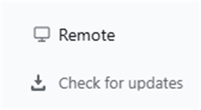
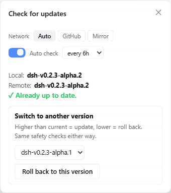
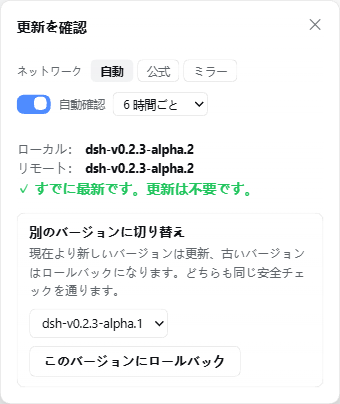
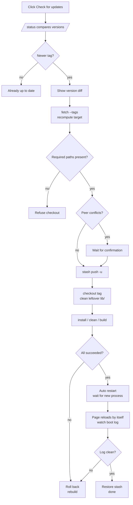

<div align="center">


# dsh-update

**The update plugin for DeepSeek Harness web.**

Upgrade DSH with one click in the sidebar — no more typing out a string of git and pnpm commands.

[](CHANGELOG.en.md)
[](LICENSE)
[](#compatibility)
[](#installation)

</div>

<p align="right"><a href="README.md">简体中文</a> · <b>English</b> · <a href="README.ja.md">日本語</a></p>

**Contents** · [The problem it solves](#the-problem-it-solves) · [What it looks like](#what-it-looks-like) · [Features](#features) · [Installation](#installation) · [Configuration](#configuration) · [How it works](#how-it-works) · [Compatibility](#compatibility) · [Troubleshooting](#troubleshooting) · [Development](#development)

---

## The problem it solves

Running DSH web from source means every upgrade is a long string of hand-typed commands — pull the tag, stop the service, check out, install, clean, build, start the service again. Any step can go wrong on the way, and at the end you still have to bring the service back up yourself.

Install the plugin and the bottom of the sidebar gains a "Check for updates" button: it tells you whether a newer version exists, nothing happens until you click, and when the build finishes it restarts by itself and the page comes back on its own — and if anything fails, it falls back to the previous version. The only thing left for you to do is **confirm**; everything else (fetching, stashing local changes, rebuilding, rolling back) is handled for you.

## What it looks like

### Sidebar button

The button sits at the bottom of the sidebar and **sizes itself to its label** instead of stretching across the row. Sibling buttons on the same row sit side by side when their heights are close and each takes its own row when they differ a lot — in the screenshot below Remote is 42px and ours is 32px, so each gets its own row:

<p align="left"></p>

### The check-for-updates popover

Clicking opens a popover anchored to the button, not a full-screen overlay. It is portalled to `body` with fixed positioning, so it is not clipped even when the sidebar collapses to a narrow strip:

<table>
<tr>
<td></td>
<td></td>
</tr>
<tr>
<td align="center"><sub>English</sub></td>
<td align="center"><sub>Japanese</sub></td>
</tr>
</table>

### Progress bar while updating

Once the update starts the popover collapses and the button itself becomes a progress bar. The light track behind it is the trough; the darker part is the share completed:

<p align="left"></p>

## Features

### Version comparison

Reads the `dsh-v*` release tags on origin with `git ls-remote` and compares them with the local repo. It is read-only throughout and never modifies the repo. Finding a new version starts nothing: it just turns the button into "Update available" and adds a red dot, then waits for your click.

### Three network sources

The top of the popover lets you switch the connection path on the fly; the choice is stored in `localStorage`:

| Source | Behavior |
|---|---|
| **Auto** (default) | Tries GitHub directly first; after a timeout (8s) retries each mirror on the list in turn and remembers the first one that works |
| **Official** | GitHub direct only, with an optional local proxy port (7890 for Clash / V2Ray and the like) |
| **Mirror** | Pins one of `gh-proxy.com` / `ghproxy.net` / `ghfast.top` |

An empty proxy port means a direct connection. Running an update goes through the same path you selected.

### Automatic checks

On by default, once every 6 hours, with 1 / 6 / 12 / 24 hour options. Every `dsh web` start also triggers one check. A background check that finds a new version only changes how the button looks — no dialog, no interruption; a failure quietly falls back to the next mirror.

### One-click update pipeline

```
git fetch --tags
  ↓ recompute the target from the tag just fetched (no stale-list decisions)
required-path check → peer-conflict check
  ↓
git stash push -u    (preserves your uncommitted work, untracked files included)
git checkout <tag>
  ↓ delete leftover lib/ of packages that disappeared
pnpm install → pnpm run clean → pnpm run build
  ↓ only counts as done when all three pass
auto restart → wait for the new process → page reloads by itself → watch the boot log
  ↓ unhealthy log rolls back
```

Every step is streamed as `text/event-stream`, so the output of each step shows up live.

### Automatic restart, the page comes back by itself

After a successful build, dsh restarts automatically (the completion notice shows a real countdown, about 2 seconds) — no manual page refresh and no watching a terminal:

The plugin first records the `boot` id of the current process, then requests `/api/dsh-update/ping` once every 1.5 seconds. When `boot` changes, the new process has bound the port, and only then does it call `location.reload()`.

Why not just reload: between the old process exiting and the new one listening there is a gap, and reloading right away only lands you on "This site can't be reached". Waiting until the new process is confirmed ready means the page drops straight back into a working UI.

- Polling runs for 90 seconds by default; detached background mode hands out a longer window
- Once the window is over it stops waiting and gives control back to you, rather than locking you into a loop
- If the automatic restart doesn't happen (disabled in the config, say), the completion panel shows "Restart failed, please restart manually", and the "Restart now" button beside it retries once
- When a supervisor such as systemd is detected, or `allowRestart: false` is set, there is no automatic restart and therefore no polling

### Four safety gates

The dangerous part of an update is not failing to fetch — it is ending up with a checkout that won't run. The four checks below each map to a real failure:

| Gate | Blocks | How to release it |
|---|---|---|
| **Required paths** | The target tag is missing `packages/client/ui-context-menu/package.json` (which provides `contextMenus`) — after checkout the web UI sits at `Failed to load plugins` | Click "Check out anyway" in the panel, or set `allowMissingRequiredPaths: true`; `requiredPaths: []` turns the check off entirely |
| **Peer conflicts** | Installed plugins' harness / dsh `peerDependencies` don't cover the target version (WorkBuddy and friends pin exact versions) | Listed for you to confirm by default; can be set to `block` / `ignore` |
| **Leftover lib/** | A `lib/` directory gitignored by an older version survives on disk after the new tag deletes that package (the classic case: an old `ui-context-menu/lib` keeps injecting `contextMenus`) | Automatic: deletes only the `lib/` of packages that exist in the old tree but not the new one, under the whitelisted top-level dirs (`packages/`, `apps/`) |
| **Startup log** | The build succeeded but the log after restart contains `did not activate` / `Failed to load plugins` | Automatic rollback, no intervention needed |

A failing `pnpm run clean` aborts and rolls back the same way — it is never treated as a warning you can build past. An exit code of 0 doesn't count as success either: the startup log has to stay clean for the observation window (15 seconds by default).

### Rolling back

To go back, pick a historical `dsh-v*` tag under "Switch to another version". Same dropdown, same pipeline; the button label follows whether the version is higher or lower:

```
higher than current → update to this version
lower than current  → roll back to this version
both go through the same safety checks
```

A successful rollback also restarts automatically and refreshes the page, with nothing to do by hand.

When a rollback is blocked (conflicting local changes, a target missing a required path, incompatible peers), the popover lists the reason directly: which files conflict, which plugin is incompatible, which path is missing — and what to do about it.

### Your local changes are never lost

- `git stash push -u` before updating (untracked files included), then `stash apply` restores them as they were on success
- If the new version touches the same file and conflicts, the changes **stay safely in the stash** and the panel says so explicitly: "not lost — you can run `git stash apply` by hand in the repo directory"
- The panel has an "Auto-stash and continue updating / rolling back" button, so you never need to open a terminal
- Before rolling back it runs `stash push -u` again, so a rollback can't wipe out your changes

### Automatic rollback on failure

After switching to the new version, if install / clean / build fails at any point, or the startup log is unhealthy after the restart, it automatically `git checkout`s back to the original version and rebuilds. If pnpm fails again during the rollback it does not pretend to succeed — it tells you plainly that "your local changes are safely stored in the git stash", because the working tree state is unknown at that point and handing it to you beats gambling automatically.

### Trilingual interface

Chinese / English / Japanese. The language is resolved in order from `ctx.locale` (DSH's LocaleRuntime), `<html lang>` and `navigator.language`, and it listens for `<html lang>` changes to switch live without a refresh. Any other language falls back to English — no half-translated UI.

### Concurrency and security boundaries

- Only one update task at a time; a duplicate trigger returns 409
- All 5 API routes accept local requests only — LAN and phone origins get 403
- `/restart` validates more strictly: proxy headers such as `x-forwarded-for` are rejected, and Origin must match Host exactly
- Every git invocation forces `GIT_TERMINAL_PROMPT=0`; credentials are never requested interactively
- Rollback targets must carry the `dsh-v*` prefix — arbitrary refs are rejected

## Installation

> This plugin is a **Profile Bundle**: `package.json` declares `dsh.bundle` and ships `cordis.patch.yml`. That means `dsh plugin add` **installs and activates it in a single command**, with no config file to edit by hand.

### From npm (recommended)

```bash
dsh plugin --profile web add @zhucy123/dsh-update
dsh web
```

### From GitHub

```bash
dsh plugin --profile web add git+https://github.com/Zhucy123/dsh-update.git
dsh web
```

### From a local checkout (for development)

`link:` creates a symlink in `node_modules` pointing at the source directory, so code changes need no reinstall.

```bash
dsh plugin --profile web add link:<absolute path to the source directory>
dsh web
```

```powershell
# Windows PowerShell example
dsh plugin --profile web add link:C:\Users\me\workspace\dsh-update
```

> **After installing you must fully restart `dsh web`.** Not a page refresh, and not another `dsh web` in a second terminal either — stop the old process, then start it.

> The plugin ID and the route prefix are both `dsh-update`; the bare `dsh-update` name on npm was already registered by a third party as a 1.3KB placeholder shell, which is why it is published under a scope. Once installed, you can't tell the difference.

## Configuration

Everything here is optional. Set it in the user patch layer of the profile's `cordis.patch.yml`:

```yaml
# ~/.dsh/profiles/web/cordis.patch.yml
plugins:
  '@zhucy123/dsh-update':
    peerConflictPolicy: confirm
    bootHealthWindowMs: 20000
```

| Field | Env var | Description | Default |
|---|---|---|---|
| `repoDir` | `DSH_UPDATE_REPO_DIR` | Root of the repo to update (must be a git checkout) | The first directory containing `.git` walking up from `process.cwd()` |
| `gitProxy` | `DSH_UPDATE_GIT_PROXY` | Mirror prefix used after a direct connection fails; `""` disables mirror fallback | `https://gh-proxy.com/` |
| `allowRestart` | — | Whether self-restart is allowed; automatically disabled when a supervisor such as systemd is detected | `true` |
| `autoRestart` | — | Whether to restart ~2 seconds after a successful update / rollback and refresh the page once the new process is ready | `true` |
| `windowsDetachedUpdate` | — | Detached background update on Windows, see below | `false` |
| `requiredPaths` | `DSH_UPDATE_REQUIRED_PATHS` | Relative paths that must exist in the target tag before checkout. An empty array disables the check | `["packages/client/ui-context-menu/package.json"]` |
| `allowMissingRequiredPaths` | — | When `true`, a missing path only warns and the checkout still proceeds | `false` |
| `orphanLibRoots` | — | Top-level repo directories where leftover `lib/` may be cleaned up | `["packages", "apps"]` |
| `peerConflictPolicy` | — | `confirm` (list, then confirm) / `block` (reject outright) / `ignore` (log only) | `confirm` |
| `profilesDir` | `DSH_UPDATE_PROFILES_DIR` | Profile root scanned for plugin peers | `~/.dsh/profiles` |
| `bootHealthWindowMs` | — | Milliseconds to keep watching the startup log after the port comes up (0–120000). Skipped when automatic restart is off | `15000` |

### Detached updates on Windows

A running `dsh` on Windows may be holding file handles on the old `node_modules`, so an in-process `pnpm install` can't delete the locked packages (`[WARN] Failed to remove ...`) and trips a rollback instead.

With `windowsDetachedUpdate: true`, once the git steps are done the update is handed to a detached background process: this process exits and releases the handles, and the background process waits for the port to be freed, then runs install → stash apply → clean → build — restarting on success, rolling back on failure, and writing a log to `%TEMP%\dsh-update-apply-*.log`.

**The cost is that the page disconnects at the handover.** The background process still restarts and waits for you, but because the connection was already dropped during the handover, you have to reopen the page yourself. That is why this is off by default: the in-process path keeps everything visible and refreshes the page for you, so it is only worth enabling when you genuinely run into a file lock.

## How it works



### API routes

| Route | Method | Description |
|---|---|---|
| `/api/dsh-update/status` | GET | Version comparison plus the local list of historical tags; `?source=&mirror=&proxyPort=` re-runs the check on the current network source |
| `/api/dsh-update/ping` | GET | A very lightweight liveness probe returning `boot` / `pid` / `inFlight`, used only by restart polling (no git reads, no profile scan) |
| `/api/dsh-update/release-notes?tag=` | GET | The GitHub Releases notes for the given version |
| `/api/dsh-update/run` | POST | Streams an update / rollback (`text/event-stream`) |
| `/api/dsh-update/restart` | POST | Starts a new process from the original launch command |

## Compatibility

| Platform | Status | Notes |
|---|---|---|
| Windows | ✅ | `pnpm` goes through its `.cmd` shim via the shell; restart is launched silently with PowerShell `-WindowStyle Hidden` + `windowsHide` |
| Linux | ✅ | Falls back to `corepack pnpm` when pnpm is missing |
| macOS | ✅ | Same as Linux |

- Every path goes through `node:path`; no hard-coded separators
- On POSIX the restart uses `detached: true` so the new process becomes its own session — closing the terminal that launched it doesn't affect the service, and output is redirected to a log in tmpdir
- Self-restart is disabled automatically under systemd (the supervisor takes care of it); unrecognized setups such as launchd are allowed by default

**Requirements**:

- DSH running from source — a cloned deepseek-harness repo whose origin carries `dsh-v*` release tags
- Node.js ≥ 18, git, pnpm

## Troubleshooting

| Symptom | What to do |
|---|---|
| The button doesn't appear after installing | 99% of the time you didn't **fully restart** (you only refreshed the page). Stop the old `dsh web` process and start it again |
| The panel is stuck at "Checking version…" | A network problem. Switch the source to "Mirror" and retry; a failed check reports the direct and mirror errors separately in the message |
| "An update is already running" (409) | The concurrency guard — wait for the current task to finish |
| It reports a missing required path | That target tag would break the web UI (typically missing `ui-context-menu`). Choose another version, or click "Check out anyway" once you accept the risk |
| Peer conflicts are listed for WorkBuddy and other plugins | Installed plugins pin harness / dsh to an older version. You can confirm and continue, or change `peerConflictPolicy` |
| `MISSING_EXPORT` / it won't open after updating | A leftover `lib/` references an export that no longer exists. The plugin runs `pnpm run clean` and clears the `lib/` of vanished packages automatically; doing it by hand, remember `pnpm run clean && pnpm run build` |
| `Failed to load plugins` / `did not activate` in the startup log | The plugin has already rolled back; reopen the panel once the page recovers to see the rollback result |
| It still says "update available" after updating | A successful update refreshes the page automatically, and this doesn't happen after that refresh. A separate tab, or a panel opened before the refresh, stays on the old view — click "Check again" |
| The button stays a green check and won't respond | Fixed in v1.9.0: a click in the `done` / `error` state returns it to `idle` and re-checks |
| The page didn't come back after updating | It means the automatic restart didn't take effect. The panel shows "Restart failed, please restart manually" — click "Restart now" beside it, or press F5 and start dsh yourself. Polling waits 90 seconds by default, then hands control back to you |

### Verifying the install

```powershell
# 1. The dependency is recorded
Get-Content $HOME\.dsh\profiles\web\package.json | Select-String dsh-update

# 2. The dependency is in place (a link: install shows up as a Junction)
Get-Item $HOME\.dsh\profiles\web\node_modules\@zhucy123\dsh-update
```

Then restart `dsh web`; a "Check for updates" button should appear at the bottom of the sidebar.

## Development

```bash
git clone https://github.com/Zhucy123/dsh-update.git
cd dsh-update
node --test test/*.test.mjs
dsh plugin --profile web add link:$(pwd)
```

```
lib/index.js                2328 lines  host side: API routes, update/rollback pipeline, stash, boot health check
lib/client.js               2250 lines  browser side: sidebar button, popover, i18n (classic script, no build)
lib/safety.js                592 lines  pure functions: tag comparison, peer conflicts, path whitelist, env cleanup
test/update-safety.test.mjs  477 lines  20 tests
icon.svg                      18 lines  plugin icon (128 grid)
```

```bash
node --test test/*.test.mjs
# ℹ tests 20 · pass 19 · fail 0 · skip 1
```

The only skipped test is the one that has to create a symlink — without developer mode on Windows `symlinkSync` throws EPERM, so it was changed to probe for the capability and skip instead. It isn't broken.

6 of the 20 are **runtime behavior tests** — they really spawn git subprocesses and really run a rollback that is meant to fail — not regexes over source:

```
runUpdateStreaming resolves and closes the stream on a non-git directory
buildDoneEvent keeps autoRestart honest for both modes
createProcessRunners streams a real git command and reports its exit code
performRollback reports failure instead of throwing when it cannot restore
sanitizeGitEnv strips every malformed GIT_CONFIG_* shape git rejects
a git call survives a poisoned GIT_CONFIG_* environment
```

### Hard constraints (read before touching the code)

1. **`lib/client.js` has no build step** — it is a classic script registered through `window.__ModuleLoader__.load({ id, factory })`, and pulls in platform modules with `require("react")` internally. It can't become ESM/TS, can't use bare imports, and can't gain a bundler.
2. **`lib/client.js` is CRLF with tab indentation** and holds about 185 `tr("中文原文")` dictionary entries. Editing it requires exact matching (including `\r\n`).
3. **React is limited to `useState / useEffect / useRef / useCallback` plus `createElement` (aliased `h`)** — no JSX.
4. **All host-side routes are loopback-only.** That is a deliberate security boundary — don't open it up "to make testing easier".

### Two kinds of change, two ways to take effect

| Changed | Takes effect |
|---|---|
| `lib/client.js` | A hard refresh of the page (with a `link:` install) |
| `lib/index.js` / `lib/safety.js` / `package.json` | A restart of `dsh web` |

### Line endings and `.gitattributes`

The repo standardizes on `* text=auto eol=crlf`: stored as LF inside the repo, checked out as CRLF in the working tree. This overrides a system-level `core.autocrlf=true` and stops the `LF will be replaced by CRLF` notice from recurring on every commit.

> If you run into "I added `.gitattributes` but the warnings are still there", first look for `-text` in `git ls-files --eol` — usually some file carries a stray bare CR (a `\r` not followed by `\n`), git classifies it as binary, and the attribute doesn't apply to binary files.

## Version history

Currently **v2.0.0**. See [CHANGELOG.en.md](CHANGELOG.en.md) for the full per-version history.

## Privacy

**This repo contains no local user data.** The source mentions only the public product name `deepseek-harness` and DSH's default port `3080` — no usernames, absolute working directories, credentials or tokens. The repo contains only `lib/`, `test/`, `docs/`, `package.json`, `cordis.patch.yml`, `icon.svg`, `README.md` / `README.en.md` / `README.ja.md`, `CHANGELOG.md` / `CHANGELOG.en.md` / `CHANGELOG.ja.md`, `LICENSE`.

## License

MIT © Zhucy123
