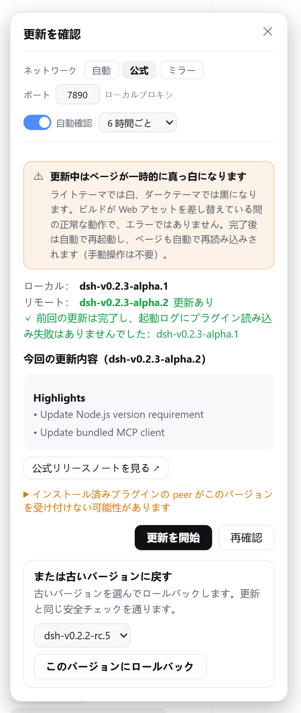
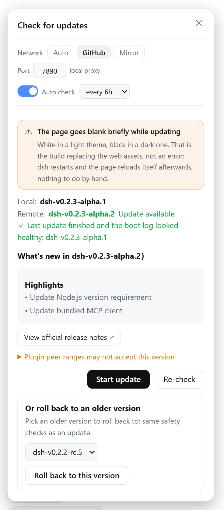
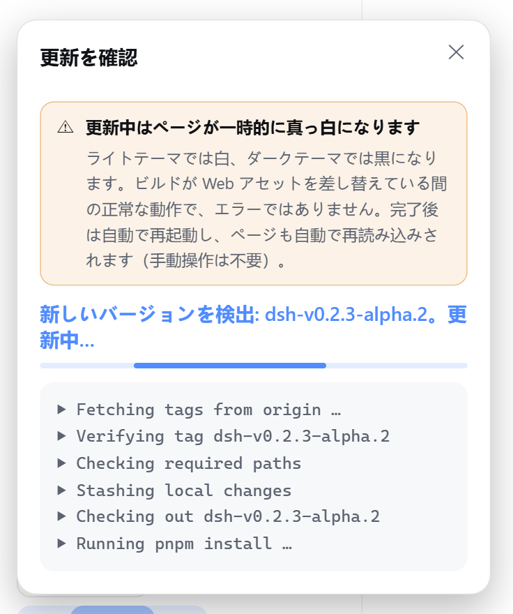
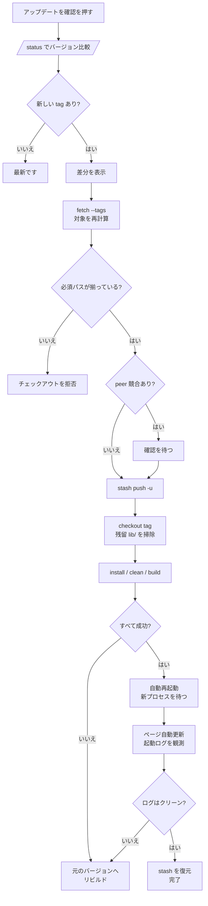

<div align="center">


# dsh-update

**DeepSeek Harness ウェブ版（web）のアップデートプラグインです。**

サイドバーのボタンを 1 回押すだけで DSH をアップグレードできます。git や pnpm のコマンドを手打ちする必要はもうありません。

[](CHANGELOG.ja.md)
[](LICENSE)
[](#互換性)
[](#インストール)

</div>

<p align="right"><a href="README.md">简体中文</a> · <a href="README.en.md">English</a> · <b>日本語</b></p>

**目次** · [何を解決するのか](#何を解決するのか) · [どんな見た目か](#どんな見た目か) · [機能](#機能) · [インストール](#インストール) · [設定](#設定) · [動作の仕組み](#動作の仕組み) · [互換性](#互換性) · [トラブルシューティング](#トラブルシューティング) · [開発](#開発)

---

## 何を解決するのか

ソースから起動している DSH web をアップグレードするには、これまで長いコマンド列を手で叩く必要がありました。tag を取得し、サービスを止め、checkout、install、clean、build、そしてまたサービスを起動し直す——途中のどの手順でも失敗する可能性があり、最後には自分でサービスを戻さなければなりませんでした。

プラグインを入れると、サイドバーの下部に「アップデートを確認」ボタンが増えます。新しいバージョンがあるかを確認し、あなたが押して初めて更新が始まります。ビルドが終われば自動で再起動し、ページもひとりでに戻ってきます。途中で失敗すれば元のバージョンへ戻ります。あなたが判断するのは**確認**の 1 点だけです。それ以外（取得、ローカル変更の退避、リビルド、ロールバック）はすべてプラグインが処理します。

## どんな見た目か

### サイドバーのボタン

ボタンはサイドバーの下部にあり、**幅は文字の長さに合わせて決まり**、行いっぱいには広がりません。同じ行の兄弟ボタンは高さが近ければ横に並び、差が大きければそれぞれ 1 行を占めます。下の図では Remote が 42px、このプラグインが 32px なので、それぞれ別の行になっています。

<p align="left"></p>

### アップデート確認パネル

クリックするとボタンに貼り付くようにポップオーバーが開きます。全画面のオーバーレイではありません。`body` に portal され固定配置されるため、サイドバーを折りたたんで細い帯にしても切れません。

<table>
<tr>
<td></td>
<td></td>
</tr>
<tr>
<td align="center"><sub>日本語</sub></td>
<td align="center"><sub>English</sub></td>
</tr>
</table>

### 実行中の進捗表示

更新を開始してもウィンドウは閉じず、その場で進捗ウィンドウに変わります。右上の ✕ でいつでも閉じられ、閉じても処理は続きます。サイドバーのボタンを押せば再び開けます。

中には左から右へ流れて繰り返す帯があります。サーバーは段階しか返さず全体の所要時間は分からないため、パーセントは表示しません。動いていれば止まっていない、という表現です。

サイドバーのボタンも進行形の文言（インストール中、ビルド中…）に変わり、同じ帯が流れます。完了すると緑になり「更新完了」「ロールバック完了」と表示します。

<table>
<tr>
<td valign="top"></td>
<td valign="top"></td>
</tr>
<tr>
<td align="center"><sub>進捗ウィンドウ（✕ で閉じても処理は続行）</sub></td>
<td align="center"><sub>サイドバーボタン</sub></td>
</tr>
</table>

## 機能

### バージョン比較

`git ls-remote` で origin 上の `dsh-v*` リリースタグを読み、ローカルと比較します。終始読み取りのみで、リポジトリには手を加えません。新しいバージョンを見つけても勝手には動かず、ボタンを「新しいバージョンあり」に変え、文字の**右側**に赤い点を付けるだけなので、押されるのを待ちます(独立した要素として並べるので、最後の文字に重なりません)。

### 3種類のネットワーク経路

パネル上部で経路をその場で切り替えられ、選択(公式モードのプロキシポートやミラー id を含む)はブラウザの `localStorage` に保存され、次回パネルを開くときに自動復元されます。毎回選び直す必要はありません。

| 経路 | 動作 |
|---|---|
| **自動**（デフォルト） | まず GitHub へ直接接続し、タイムアウト（8 秒）後は `gitProxy` とミラー一覧（`gh-proxy.com` / `ghproxy.net` / `ghfast.top`）を順に再試行し、最初に成功したミラーを記憶します |
| **公式** | GitHub 直結のみ。ローカルプロキシのポート（Clash / V2Ray の 7890 など）を指定できます |
| **ミラー** | `gh-proxy.com` / `ghproxy.net` / `ghfast.top` のいずれかを指定。リポジトリの `origin` が GitHub でない場合は続行せず即座にエラーを返します |

プロキシポートが空なら直接接続です。「公式 + ローカルプロキシポート」を選んだ場合は**全工程で有効**になり、バージョン確認（`git ls-remote`）や更新／切り戻し時の取得（`git fetch`）だけでなく、Node 標準の `node:http` / `node:tls` による HTTP `CONNECT` トンネルを通じて `/api/dsh-update/release-notes` のリリースノート取得にも適用されます。

### 自動チェック

デフォルトで有効、6 時間ごとに確認し、1 / 6 / 12 / 24 時間から選べます。`dsh web` の起動時にも毎回 1 回確認します。バックグラウンドで新バージョンを見つけてもボタンの見た目が変わるだけで、ダイアログも出さず作業も中断しません。失敗した場合は黙ってミラーを切り替えて再試行します。

### ワンストップ更新

```
git fetch --tags
  ↓ 取得した tag から対象を再計算（古い一覧で判断しない）
必須パスの確認 → peer 競合の確認
  ↓
git stash push -u    （未コミットの変更を退避。未追跡ファイルも含む）
git checkout <tag>
  ↓ 消えたパッケージの残留 lib/ を削除
pnpm install → pnpm run clean → pnpm run build
  ↓ 3 つすべて通って初めて完了
自動再起動 → 新プロセスの起動待ち → ページ自動更新 → 起動ログを観測
  ↓ ログが不健全ならロールバック
```

全体が `text/event-stream` でストリーミング返却され、各ステップの出力がリアルタイムに表示されます。

### 自動再起動とページの自動復帰

ビルドが成功すると dsh は自動で再起動します（完了メッセージのカウントダウンは実際の残り時間で、約 2 秒）。ページを手動で再読み込みする必要も、ターミナルを見張る必要もありません。

プラグインはまず現在のプロセスの `boot` id を記録し、それから 0.6 秒ごとに `/api/dsh-update/ping` を叩きます（初回は実行終了の 250 ミリ秒後）。`boot` が変わっていれば新しいプロセスがポートを掴んだ証拠なので、その時点で初めて `location.reload()` します。同じ `boot` 基準はブラウザの `localStorage` にも保存され、ビルドが Web アセットを置き換えてページが真っ白になり SSE が切れても、再読み込み後のページが単独で `/ping` を叩いて再読み込みを完了します。

再読み込みの前に、そもそもこのページに必要かをもう一度確認します。`boot` の前半分はホストプロセスの起動時刻なので、それがこのページの読み込み時刻より前なら、その新プロセスはもともとこのページを配信しています——マーカーを消すだけで再読み込みはしません。そのため、ご自身で F5 を押した後に二度目の自動再読み込みが走ることはありません。

そのままリロードしないのは、旧プロセスが終了してから新プロセスがポートを待ち受けるまでの間に空白時間があり、すぐリロードすると「このサイトにアクセスできません」に当たるからです。新プロセスの準備完了を確認してからリロードするので、ページはそのまま通常の画面に戻ります。

実際に測ると、ページが本当に使えない時間は体感よりずっと短いです。実更新を 2 秒間隔でサンプリングしたところ、`dist` が空だったのは**約 2 秒**だけ、再起動の空白時間(新プロセスがまだポートを掴んでいない)は**約 18 秒**でした。その前のホスト `tsc` コンパイルの数分間は `dist` が無傷のままで、ページは普通に使えます——この区間では白屏は発生しません。

- ポーリングはデフォルトで 90 秒。バックグラウンド分離モードではより長い猶予が渡されます
- 猶予を超えたら待つのをやめ、制御をあなたに返します。無限ループに閉じ込めることはしません
- 自動再起動が効かない場合（設定で無効になっているなど）は、完了パネルに「再起動に失敗しました。手動で再起動してください」と表示され、隣の「今すぐ再起動」で 1 回だけやり直せます
- systemd などの supervisor 管理下であること、または `allowRestart: false` が設定されていることを検出した場合は自動再起動を行わず、ポーリングもしません

### 4つのセーフティゲート

アップデートで最も危険なのは「取得できないこと」ではなく「取得したものを使えないこと」です。次の 4 つのチェックは、4 種類の実際の障害に対応しています。

| ゲート | 何を止めるか | 解除方法 |
|---|---|---|
| **必須パス** | 対象 tag に `packages/client/ui-context-menu/package.json`（`contextMenus` を提供）が無い——チェックアウトすると Web UI が `Failed to load plugins` で止まる | パネルの「それでもチェックアウト」を押す、`allowMissingRequiredPaths: true` を設定する、または `requiredPaths: []` でチェック自体を無効化 |
| **Peer 競合** | **有効化済み**プラグインの harness / dsh `peerDependencies` が対象バージョンをカバーできない（WorkBuddy のようにバージョンを固定するもの）。`dsh.profile.bundles` の有効なバンドルのみを走査し（シンボリックリンク / Junction 導入ディレクトリにも対応）、空白区切り演算子やハイフン範囲を含む標準 npm semver 範囲に対応。prerelease 対象は安定版でも二重確認して誤検知を防止 | デフォルトでは一覧を出して確認を求めます。`block` / `ignore` に変更できます |
| **残留 lib/** | 旧バージョンで gitignore されていた `lib/` が、パッケージディレクトリごと新 tag に消された後もディスクに残る（典型例：古い `ui-context-menu/lib` が `contextMenus` を注入し続ける） | 自動処理：ホワイトリストのルート（`packages/`、`apps/`）配下で「旧ツリーにあり新ツリーに無い」パッケージの `lib/` だけを削除 |
| **起動ログ** | ビルドは成功したのに、再起動後のログに `did not activate` / `Failed to load plugins` が出る | 自動ロールバック。手を出す必要はありません |

`pnpm run clean` の失敗も同じく中断・ロールバックします。警告扱いにしてビルドを続けることはありません。ビルドの終了コードが 0 でも成功とはみなしません。起動ログが観測ウィンドウ（デフォルト 15 秒）の間クリーンであり続けて初めて完了です。

### バージョン切り戻し

戻したいときはパネルの「または古いバージョンに戻す」から現在より古い `dsh-v*` tag を選びます。ボタンは「このバージョンにロールバック」で固定です。tag の比較と並び順では prerelease バージョン（`alpha.10` と `alpha.2` など）に完全な semver 数値比較を採用しています。バージョン一覧には過去のバージョンのみが並びます——アップグレードは上部の「更新を開始」が担当するため重複せず、「すでに最新です」のときもロールバック一覧だけが表示され、矛盾する選択肢は出ません。ロールバックも更新と同じ安全チェックを通ります。

切り戻しに成功した場合も同様に自動再起動し、ページも自動で更新されるので手動操作は不要です。

切り戻しが安全ゲートでブロックされたとき（ローカル変更の衝突、対象バージョンに必須パスが無い、peer が非互換など）は、確認カードに理由が並びます。どのファイルが衝突したか、どのプラグインが非互換か、どのパスが欠けているかが表示され、ボタンは「それでもロールバックする」になります。「それでも続行」を押すとそれまでの進捗を保ったまま続行し、「キャンセル」を押すとボタンは通常の状態に戻ります。競合の詳細はデフォルトで折りたたまれ、画面を埋め尽くしません。

### ローカルの変更は失われない

- 自動 stash 前に `git status --porcelain` で変更有無を判定し、作業ツリーがクリーンなときは `git stash push` をスキップして既存の `stash@{0}` に誤って触れないようにします
- 変更がある場合は更新前に `git stash push -u`（未追跡ファイルを含む）し、成功後にそのまま `stash apply` で戻します
- 新バージョンが同じファイルに触れて `stash apply` で衝突した場合は、**stash エントリを破棄せず残したまま** `git reset --hard HEAD` で作業ツリーをクリーンに復旧してからビルドを続行し、パネルに「失われていません。リポジトリのディレクトリで手動で `git stash apply` できます」と明示します
- パネルには「自動で stash して更新を続行 / 切り戻す」ボタンがあるので、自分でターミナルを開く必要はありません
- ロールバックの前にも `git status --porcelain` で確認し、変更がある場合のみ再度 `stash push -u` するので、ロールバックでユーザーの変更が消えることはありません

### 失敗時の自動ロールバック

新しいバージョンへ切り替えた後、install / clean / build のいずれかが失敗した場合、または再起動後の起動ログが不健全な場合は、自動で `git checkout` により元のバージョンへ戻してリビルドします。ロールバック中に pnpm がまた失敗しても、成功したふりはせず「ローカルの変更は git stash に安全に保存されています」と明確に伝えます。その時点の作業ツリーの状態は不確定なので、自動で冒険するより手動で処理してもらうほうが確実だからです。

### 3言語インターフェース

中国語 / English / 日本語。言語は `ctx.locale`（DSH の LocaleRuntime）、`<html lang>`、`navigator.language` の順に決定し、`<html lang>` の変化を監視してリロードなしに即座に切り替えます。それ以外の言語は一律英語にフォールバックし、中途半端な翻訳は出しません。

### 同時実行と安全境界

- 同時に実行できる更新タスクは 1 つだけ。重複して起動すると 409 を返します
- 5 つの API ルートはすべて DSH の**共有 `/api` 認証チャネル**(`ctx.connection.fetch.register`)に登録されます。ホストがプラグインに到達する前に Host/Origin 信頼フェンス(DNS rebinding / クロスオリジン対策)とブラウザのログインチェックを適用するため、ブラウザで開いている任意のウェブページから呼び出すことはできません。401/403 はプラグインではなくホストが返します
- `/run` や `/restart` などシステムを変更するエンドポイントもログインで保護されます。プラグイン側はポリシーチェック(supervisor / `allowRestart` / 実行中タスク / ターゲットタグのホワイトリスト)のみを行います
- `POST /api/dsh-update/run` はリクエストボディを 64 KiB 以下に制限（超過時は 413）し、解析結果が JSON オブジェクトであることを検証します
- 会話実行中の警告から「強制更新」の二次確認へ進んでも、自動 stash（`stash`）などの選択はそのまま引き継がれます。`done` / `error` 状態でサイドバーボタンを押して再確認するときも選択済みのネットワーク経路・プロキシ設定を維持します
- 再起動およびバックグラウンド更新のポート待ち受け確認では `127.0.0.1` と `::1`（IPv6 ループバック）の両方をチェックします
- すべての git 呼び出しで `GIT_TERMINAL_PROMPT=0` を強制し、対話的に認証情報を求めることは決してありません
- 切り戻し先は `dsh-v*` プレフィックスに限定し、任意の ref は拒否します
- DSH `>=0.2.3`(アルファ含む)が必要です。共有 `/api` の准入モデルは 0.2.3 で安定しました。`engines.dsh: ">=0.2.3-0"` により `0.2.3-alpha.*` も満たします

## インストール

> 本プラグインは **Profile Bundle** です。`package.json` が `dsh.bundle` を宣言し、`cordis.patch.yml` を同梱しています。そのため `dsh plugin add` の **1 コマンドでインストールと同時に自動有効化**され、設定ファイルを手で書き換える必要はありません。

### npm から

```bash
dsh plugin --profile web add @zhucy123/dsh-update
dsh web
```

### GitHub から

```bash
dsh plugin --profile web add git+https://github.com/Zhucy123/dsh-update.git
dsh web
```

### ローカルソースから

開発用です。`link:` は `node_modules` にソースディレクトリを指すシンボリックリンクを作るので、コードを変えても再インストールは不要です。

```bash
dsh plugin --profile web add link:<ソースディレクトリの絶対パス>
dsh web
```

```powershell
# Windows PowerShell での記述例
dsh plugin --profile web add link:C:\Users\me\workspace\dsh-update
```

> **インストール後は `dsh web` を完全に再起動してください。** ページの再読み込みでは駄目ですし、別のターミナルでもう一度実行することでもありません。旧プロセスを止めてから起動し直す必要があります。

> プラグイン ID とルートのプレフィックスはいずれも `dsh-update` です。npm 上のベア名 `dsh-update` は第三者が 1.3KB のプレースホルダー（中身のないパッケージ）として登録済みのため、scoped 名で公開しています。インストール後の見え方は変わりません。

## 設定

すべて任意です。profile の `cordis.patch.yml` ユーザーパッチ層に書きます。

```yaml
# ~/.dsh/profiles/web/cordis.patch.yml
plugins:
  '@zhucy123/dsh-update':
    peerConflictPolicy: confirm
    bootHealthWindowMs: 20000
```

| フィールド | 環境変数 | 説明 | デフォルト |
|---|---|---|---|
| `repoDir` | `DSH_UPDATE_REPO_DIR` | 更新対象リポジトリのルート（git checkout であること） | `process.cwd()` から上へ辿り、最初に見つかった `.git` を含むディレクトリ |
| `gitProxy` | `DSH_UPDATE_GIT_PROXY` | 直結に失敗したときのミラープレフィックス。`""` でミラーへのフォールバックを無効化 | `https://gh-proxy.com/` |
| `allowRestart` | — | 自己再起動を許可するか。systemd などの supervisor を検出すると自動で無効化 | `true` |
| `autoRestart` | — | 更新 / 切り戻しの成功後に約 2 秒で自動再起動し、新プロセスの準備完了を待ってからページを更新するか | `true` |
| `windowsDetachedUpdate` | — | Windows でのバックグラウンド分離更新。後述 | `false` |
| `requiredPaths` | `DSH_UPDATE_REQUIRED_PATHS` | チェックアウト前にターゲット tag へ存在していなければならない相対パス。空配列 = チェック無効 | `["packages/client/ui-context-menu/package.json"]` |
| `allowMissingRequiredPaths` | — | `true` ならパス欠落は警告のみで、そのままチェックアウトする | `false` |
| `orphanLibRoots` | — | 残留 `lib/` の掃除を許可するリポジトリ直下のディレクトリ | `["packages", "apps"]` |
| `peerConflictPolicy` | — | `confirm`（一覧を出して確認）/ `block`（即座に拒否）/ `ignore`（ログのみ） | `confirm` |
| `profilesDir` | `DSH_UPDATE_PROFILES_DIR` | プラグインの peer を走査する profile のルート | `~/.dsh/profiles` |
| `bootHealthWindowMs` | — | ポートが上がった後に起動ログを観測し続けるミリ秒数（0–120000）。自動再起動が無効ならこのチェックは行わない | `15000` |

### Windows でのバックグラウンド分離更新

Windows で動いている `dsh` は古い `node_modules` のファイルハンドルを掴んでいることがあり、プロセス内の `pnpm install` ではロックされたパッケージを削除できず（`[WARN] Failed to remove ...`）、そのままロールバックが走ってしまいます。

`windowsDetachedUpdate: true` を設定すると、更新は git ステップの完了後に detached なバックグラウンドプロセスへ引き継がれます。本プロセスが終了してハンドルを解放し、バックグラウンドプロセスはポートが解放されるのを待ってから install → stash apply → clean → build を実行します。成功すれば自動再起動、失敗すればロールバックし、ログを `%TEMP%\dsh-update-apply-*.log` に書き出します。

**代償として、引き継ぎの瞬間にページの接続が切れます。** バックグラウンドプロセスも完了後に自動再起動して復帰を待ちますが、引き継ぎの間に接続が切れているため、ページは自分で開き直す必要があります。そのためこの項目はデフォルトで無効です。プロセス内の経路なら全体が見えたままページも自動更新されます。本当にファイルロックに当たったときだけ有効にする価値があります。

## 動作の仕組み



### API ルート

| ルート | メソッド | 説明 |
|---|---|---|
| `/api/dsh-update/status` | GET | バージョン比較 + ローカル履歴 tag の一覧。`?source=&mirror=&proxyPort=` で現在のネットワーク経路に切り替えて再問い合わせできる |
| `/api/dsh-update/ping` | GET | 極めて軽量な生存確認。`boot` / `pid` / `inFlight` を返し、再起動ポーリング専用（git も読まず profile も走査しない） |
| `/api/dsh-update/release-notes?tag=` | GET | 指定したバージョンの GitHub Releases の説明 |
| `/api/dsh-update/run` | POST | 更新 / 切り戻しをストリーミング実行（`text/event-stream`） |
| `/api/dsh-update/restart` | POST | 元の起動コマンドで新しいプロセスを立ち上げる |

## 互換性

| プラットフォーム | 状態 | 説明 |
|---|---|---|
| Windows | ✅ | `pnpm` はシェル経由で `.cmd` shim を実行（タイムアウト時は `taskkill /T /F` でプロセスツリー全体を終了）。再起動は PowerShell の `-WindowStyle Hidden` + `windowsHide` で静かに起動 |
| Linux | ✅ | pnpm が無い場合は自動で `corepack pnpm` にフォールバック |
| macOS | ✅ | Linux と同じ |

- パスはすべて `node:path` を経由し、区切り文字をハードコードしません
- ポート監視（再起動およびバックグラウンド更新）は `127.0.0.1` と `::1` の両方をチェックします
- POSIX の再起動は `detached: true` で新プロセスを独立セッションにするため、起動元のターミナルを閉じてもサービスは止まりません。出力は tmpdir のログへリダイレクトされます
- systemd 管理下では自己再起動を自動で無効化（起動は supervisor が担当）。launchd など未検出のケースはデフォルトで許可

**要件**：

- DSH がソース方式で動作していること——clone した deepseek-harness リポジトリで、origin に `dsh-v*` リリースタグがあること
- Node.js ≥ 18、git、pnpm

## トラブルシューティング

| 症状 | 対処 |
|---|---|
| インストールしてもボタンが出ない | 99% は**完全に再起動**していない（ページを更新しただけ）。古い `dsh web` プロセスを止めてから起動し直してください |
| パネルが「バージョンを確認しています…」のまま | ネットワークの問題です。「ミラー」経路に切り替えて再試行してください。確認に失敗した場合は、直結とミラーそれぞれのエラーがメッセージに表示されます |
| 「既に更新が実行中です」(409) と出る | 同時実行の保護です。現在のタスクが終わるのを待ってください |
| 必須パスが欠けていると表示される | 対象 tag は Web UI を壊します（典型的には `ui-context-menu` の欠落）。別のバージョンに変えるか、リスクを確認したうえで「それでもチェックアウト」を押してください |
| WorkBuddy などの peer 競合が一覧表示される | **有効化済み**プラグインが harness / dsh パッケージを旧バージョンに固定しているケースのみ集計します（インストール済み・無効のものは除外し、alpha 対象は安定版でも二重確認して誤検知を防ぎます）。確認すれば続行できますし、`peerConflictPolicy` の変更でも対処できます |
| 更新後に `MISSING_EXPORT` / 開けない | 残留した古い `lib/` が削除済みのエクスポートを参照しています。プラグインは自動で `pnpm run clean` を実行し、消えたパッケージの `lib/` を掃除します。手動で行う場合は `pnpm run clean && pnpm run build` を忘れずに |
| 起動ログに `Failed to load plugins` / `did not activate` が出る | プラグインが既に自動ロールバックしています。ページが戻ってからパネルを開き直すと、ロールバックの結果を確認できます |
| 更新後も「更新あり」と表示される | 更新成功時はページが自動で更新されるので、更新後はこの問題は起きません。別タブの場合や、更新前に開いていたパネルは古い表示のまま残るので、「再確認」を押してください |
| ボタンが緑のチェックマークのままで押せない | `done` / `error` / `confirm` 状態でクリックすると `idle` に戻り、選択済みのネットワーク経路・プロキシ設定を保ったまま再確認します。確認カードをキャンセルしても通常状態に戻ります |
| 更新後にページが自動で戻ってこない | まず数秒お待ちください。ビルドでページが真っ白になり SSE が切れても、再読み込み後のページは `localStorage` の boot 基準から `/ping` を約 0.6 秒間隔で叩き続けます。本当に再起動していない場合はパネルに「再起動に失敗しました。手動で再起動してください」と出るので、隣の「今すぐ再起動」を押してください。F5 の後に手動で dsh を起動してもかまいません。ポーリングはデフォルトで 90 秒待ち、タイムアウトすると制御を返します |

### インストールの確認

```powershell
# 1. 依存関係が記録されている
Get-Content $HOME\.dsh\profiles\web\package.json | Select-String dsh-update

# 2. 依存関係が配置済み（link: の場合は Junction）
Get-Item $HOME\.dsh\profiles\web\node_modules\@zhucy123\dsh-update
```

そのあと `dsh web` を再起動すると、サイドバーの下部に「アップデートを確認」ボタンが現れます。

## 開発

```bash
git clone https://github.com/Zhucy123/dsh-update.git
cd dsh-update
node --test test/*.test.mjs
dsh plugin --profile web add link:$(pwd)
```

```
lib/index.js                3021 行  host 側：API ルート、更新／切り戻しのパイプライン、stash、起動ヘルスチェック、HTTP CONNECT トンネル
lib/client.js               2317 行  ブラウザ側：サイドバーのボタン、ポップオーバー、i18n（classic script、ビルド無し）
lib/safety.js                696 行  純粋関数：tag 比較、peer 競合、パスのホワイトリスト、環境のクリーンアップ
test/update-safety.test.mjs 1778 行  53 件のテスト
icon.svg                      18 行  プラグインアイコン（128 グリッド）
```

```bash
node --test test/*.test.mjs
# ℹ tests 53 · pass 53 · fail 0
```

なお、`revision check and orphan lib deletion use a real git tree` はシンボリックリンクの作成が必要なため、Windows で開発者モードが無効な環境では権限をプローブして自動スキップ（52 pass / 1 skipped）されます（故障ではありません）。権限が有効な環境や Unix 系環境では 53 件すべてが通過します。

53 件のうち一部は**実行時の挙動テスト**（実際に git の子プロセスを起動し、必ず失敗するロールバックを走らせ、ローカルプロキシを立てて HTTP `CONNECT` トンネルや Fetch route の SSE ストリーミングを検証する など）で、ソースの正規表現だけではありません。

```
runUpdateStreaming resolves and closes the stream on a non-git directory
runUpdateStreaming with stash: true leaves existing stash@{0} untouched when working tree is clean
handleRun handles "null" JSON body safely without locking the latch, and returns 413 for >64KiB body
performRollback reports failure instead of throwing when it cannot restore
a git call survives a poisoned GIT_CONFIG_* environment
fetchJson tunnels HTTPS through local HTTP CONNECT proxy (normal & chunked) and forwards HTTP GET
/api/dsh-update/release-notes routes github+proxyPort through proxy and isolates error cache per proxyPort
```

### コード変更前に必読のハード制約

1. **`lib/client.js` にビルド手順はありません**——classic script で、`window.__ModuleLoader__.load({ id, factory })` により登録され、内部で `require("react")` してプラットフォームのモジュールを取得します。ESM/TS に変えることはできず、裸の import もバンドラーも使えません。
2. **`lib/client.js` は CRLF + タブインデント**で、**175** 個の `tr("中文原文")` 辞書項目を含みます。変更するときは完全一致（`\r\n` を含む）で行う必要があります。
3. **React は `useState / useEffect / useRef / useCallback` + `createElement`（別名 `h`）だけ**を使い、JSX は使いません。
4. **host 側のルートは必ず `ctx.connection.fetch.register` を使う**こと。ホストによる認証を受けます。裸の `webServer.register` + 自作 loopback fence に戻すと、ブラウザで開いている任意のページから更新を起動できてしまいます。メソッドのホワイトリストと `requestBody`(`/run` は `streaming`)はハンドラと一致させてください。

### 2種類の変更と2通りの反映方法

| 変更したもの | 反映方法 |
|---|---|
| `lib/client.js` | ページをハードリロードすれば反映（`link:` でインストールした場合） |
| `lib/index.js` / `lib/safety.js` / `package.json` | `dsh web` の再起動が必須 |

### 改行コードと `.gitattributes`

リポジトリは `* text=auto eol=crlf` で統一しています。リポジトリ内は LF で保存し、作業ツリーへのチェックアウト時に CRLF になります。これによりシステムレベルの `core.autocrlf=true` が上書きされ、コミットのたびに `LF will be replaced by CRLF` が出るのを避けられます。

> `.gitattributes` を追加したのに警告が消えない場合は、まず `git ls-files --eol` に `-text` が付いているファイルが無いか確認してください。多くの場合、そのファイルに裸の CR（`\r` の直後が `\n` でないもの）が紛れ込んでおり、git がバイナリと判定して属性が効かなくなっています。

## バージョン履歴

現在 **v2.0.1**。バージョンごとの完全な記録は [CHANGELOG.ja.md](CHANGELOG.ja.md) を参照してください。

## プライバシー

**本リポジトリにはユーザーのローカルデータは一切含まれません。** ソースに登場するのは公開製品名 `deepseek-harness` と DSH のデフォルトポート `3080` だけで、ユーザー名、絶対作業ディレクトリ、認証情報、トークンは含みません。リポジトリに含まれるのは `lib/`、`test/`、`docs/`、`package.json`、`cordis.patch.yml`、`icon.svg`、`screenshots.json`、`README.md` / `README.en.md` / `README.ja.md`、`CHANGELOG.md` / `CHANGELOG.en.md` / `CHANGELOG.ja.md`、`LICENSE` のみです。

## License

MIT © Zhucy123
