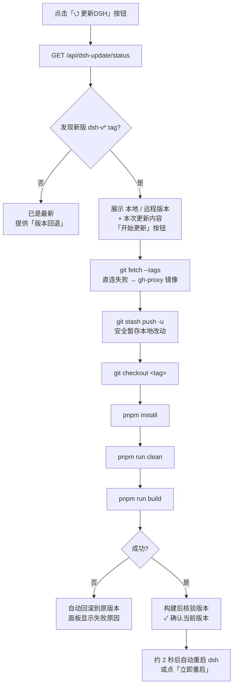

# dsh-update · ⭯ 更新DSH

> One-click update for your local [DeepSeek Harness](https://github.com/deepseek-ai/deepseek-harness) (DSH) checkout: compare versions → confirm → pull & rebuild → restart, all from a sidebar panel with live progress.


dsh-update 是 DSH Web GUI 的 **Profile Bundle 插件**:在**侧边栏底部(设置按钮上方)**加一个「⭯ 更新DSH」圆形按钮。点击后对比本地 checkout 与远程 `dsh-v*` 发布 tags;**发现新版本时不自动动手**,先展示本地/远程版本与本次更新内容,由你点「开始更新」后才执行 `git fetch → checkout → pnpm install → clean → build`,完成后自动(或一键)重启 dsh。插件界面中英双语,跟随 DSH 界面语言实时切换。

## 目录

- [特性](#特性-features)
- [界面速览](#界面速览-usage)
- [工作原理](#工作原理-how-it-works)
- [兼容性](#兼容性-compatibility)
- [要求](#要求-requirements)
- [安装](#安装-installation)
- [验证与排障](#验证与排障)
- [配置](#配置-configuration)
- [API 路由](#api-路由-api)
- [安全](#安全-security)
- [开发](#开发-development)
- [版本历史](#版本历史-changelog)
- [License](#license)

## 特性 Features

- 🆚 **版本对比** — 读取本地 checkout 的 tag / commit,与 origin 的 `dsh-v*` tags 对比(`git ls-remote`,只读)。GitHub 直连超时自动切换 `gh-proxy.com` 镜像;成功结果缓存 60 秒,重复打开秒回。
- 🛡️ **更新前先确认** — 检测到新版本只展示对比与更新内容,**绝不自动执行**;并醒目提示「更新期间整个页面可能突然变空白」的真实原因(构建阶段会替换网页资源文件),由你点击「开始更新」后才真正动手。
- ⚡ **一条龙更新** — `git fetch --tags` → 自动暂存本地改动 → `git checkout <tag>` → `pnpm install` → `pnpm run clean` → `pnpm run build`,以 `text/event-stream` 流式实时显示每步输出。
- 🧹 **构建前自动 clean** — 版本切换后旧版本残留的 gitignore `lib/` 产物可能引用新源码中已不存在的导出,导致 `MISSING_EXPORT`;构建前自动执行 `pnpm run clean` 清掉过期产物(幂等,clean 失败仅警告)。
- ✅ **构建后核验** — install + build **都成功才算完成**;build 成功后服务端重新读取 git 状态,面板显示 ✓ 已确认当前版本与更新目标一致。
- 📄 **本次更新内容** — 面板内展示该版本的 GitHub Releases 说明,按 DSH 界面语言显示中/英文段(失败降级为「查看 GitHub Releases →」链接)。
- 🔄 **自动重启 + 一键重启** — 更新/回退成功约 2 秒后**自动重启 dsh**(由服务端定时器驱动,页面已变白/断线也会发生);也可点「重启DSH / 立即重启」手动触发;重启失败(如自动重启未生效)有明确兜底提示。
- ↩️ **版本回退** — 更新后悔了?在「已是最新」结果视图下拉选择任一历史 `dsh-v*` tag 回退,流程与更新完全一致(目标 tag 白名单 + `git rev-parse --verify` 核验)。
- 💾 **本地改动安全** — 更新前自动 `git stash push -u`(含未跟踪文件,修复死循环冲突),成功后原样恢复;新版本改到同一文件时改动安全保存在 stash 不丢失,并明确提示;冲突视图提供「自动暂存并继续」。
- 🔙 **失败自动回滚** — 已切到新版本后 install/build 失败,自动 `git checkout` 回原版本(优先原 tag,否则原 commit),绝不把工作树留在半更新状态。
- 🔒 **并发保护 & 安全边界** — 同一时间只允许一个更新任务(重复触发返回 409);**4 个 API 路由全部 loopback-only**,仅本机浏览器可触发真实安装;重启路由额外拒绝代理转发。
- 🌍 **跨平台** — Windows / Linux / macOS;git / pnpm 缺失时快速失败而非挂到超时,POSIX 无 pnpm 自动回退 `corepack pnpm`。

## 界面速览 Usage

1. 启动 dsh web,侧边栏底部、设置按钮上方出现「⭯ 更新DSH」圆形按钮。
2. 点击打开面板:自动检查并显示 **本地版本 / 远程版本 / 是否可更新**。
3. 有新版 → 预览「本次更新内容」→ 点「开始更新」;等待实时进度。构建阶段页面可能突然变空白——**属正常现象,基本意味着更新已完成**。
4. 完成后面板显示 ✓ 更新成功(从→到版本、当前 commit、更新目录);约 2 秒后自动重启,页面恢复后刷新一次即可;或点「重启DSH」立即生效。
5. 已是最新 → 可用「版本回退」下拉回退到任一历史版本,过程与更新相同。

## 工作原理 How it works



更新目标目录**自动定位**:从 dsh web 进程 `process.cwd()` 向上逐级查找含 `.git` 的目录(`dsh web` 常从子目录如 `apps/cli/src` 启动);可用环境变量或插件 config 覆盖,见[配置](#配置-configuration)。

## 兼容性 Compatibility

| 平台 | 支持 | 说明 |
|------|------|------|
| Windows | ✅ | `pnpm` 经 shell 走 `.cmd` shim;重启以 PowerShell `-WindowStyle Hidden` + `windowsHide` 静默拉起(v1.6.1,`detached: false` 修复 Node.js #51018);更新走「后台分离」模式(v1.6.3,见下) |
| Linux | ✅ | pnpm 直接二进制运行;缺失时回退 `corepack pnpm`(v1.6.0) |
| macOS | ✅ | 与 Linux 相同;git / pnpm 缺失时快速失败而非挂到超时(v1.6.0) |

- 路径统一经 `node:path` 处理,不写死分隔符;git 命令跨平台。
- 重启机制跨平台:POSIX 用 `detached: true`(Node 内部 `setsid`)让新进程成为独立会话/进程组,脱离控制终端——关闭启动它的终端/窗口不影响服务,输出重定向到 tmpdir 日志文件,全程静默(v1.5.2 / v1.6.0)。
- systemd(Linux)托管时自动禁用自重启(supervisor 负责拉起);launchd 等未识别场景默认允许自重启。
- **Windows 后台分离更新(v1.6.3)**:Windows 上运行中的 dsh 服务占用旧 `node_modules` 文件句柄,进程内 `pnpm install` 删不掉被锁包(报 `[WARN] Failed to remove ...`)必然失败并触发自动回滚。故 Windows 下更新在 git 步骤(checkout)完成后**自动移交 detached 后台进程**:本进程退出释放句柄,后台进程等端口释放后执行 install → stash apply → clean → build,成功后自动重启 dsh、失败则回滚并写日志(`%TEMP%\dsh-update-apply-*.log`)。页面会在交接时断开,属正常现象,稍后刷新即可。可设 `windowsDetachedUpdate: false` 关闭(POSIX 无此问题,保持进程内更新)。

## 要求 Requirements

- 已 clone 的 **deepseek-harness** checkout(git 仓库,含 `dsh-v*` 发布 tag 的 origin)。
- 本机可访问 GitHub;不可达时插件自动走 `gh-proxy.com` 镜像(可配置更换,见[配置](#配置-configuration))。
- Node.js ≥ 18(host 端使用全局 `fetch` / `AbortController`)、git、pnpm(POSIX 无 pnpm 时自动回退 `corepack pnpm`,Node 16.9+ 自带)。

## 安装 Installation

> 本插件以 **Profile Bundle** 形态分发:`package.json` 声明了 `dsh.bundle`(携带 `cordis.patch.yml` 配置层),所以 `dsh plugin --profile web add` **一条命令装完即自动激活**——无需手动编辑任何配置文件。

### 方式一:从 npm 安装(推荐)

```bash
dsh plugin --profile web add @zhucy123/dsh-update
dsh web
```

> 注:`dsh-update` 这个裸名已被第三方注册为占位空壳包,故以 scoped 名 `@zhucy123/dsh-update` 发布;插件的 ID(侧边栏按钮、cordis 注册名、`/api/dsh-update/*` 路由前缀)仍是 `dsh-update`,安装后无感知差异。

### 方式二:从 GitHub 安装

```bash
dsh plugin --profile web add git+https://github.com/Zhucy123/dsh-update.git
dsh web
```

### 方式三:从本地源码目录安装(开发/测试)

`link:` 方式在 node_modules 里创建**符号链接(symlink)**指向你的源码目录,改源码后无需重新安装(host 端代码 `lib/index.js` 在下次启动服务时加载)。把下面的 `<源码目录>` 换成插件源码所在位置的绝对路径。

**Windows (PowerShell):**

```powershell
# 用 DSH 插件命令安装本地源码(link: 协议,符号链接,改源码即生效)
dsh plugin --profile web add link:<源码目录>
dsh web
```

**Linux / macOS:**

```bash
dsh plugin --profile web add link:<源码目录>
dsh web
```

> npm / git 安装会在 web profile 目录里执行 `pnpm add`,成功后对账插件层:检测到本插件声明 `dsh.bundle`,会自动把它追加进 `dsh.profile.bundles` 并注册进 Cordis loader 树,**一步装完即用**;源码会被**实际拷贝**到 node_modules,改动源码需重新安装(不像 `link:` 是符号链接、改源码即生效)。

装完**完全重启 DSH web**(不是刷新页面,不是另开终端跑 `dsh web`,而要停掉旧进程后重新启动),然后在**侧边栏底部、设置按钮上方**应出现「⭯ 更新DSH」圆形按钮。

## 验证与排障

安装并重启后,可以核对以下几点:

1. **依赖已写入**:`~/.dsh/profiles/web/package.json` 的 `dependencies` 里应有 `"@zhucy123/dsh-update"`(方式是 `link:` 或 git/npm)。
2. **已加入配置层**:`~/.dsh/profiles/web/package.json` 的 `dsh.profile.bundles` 列表里应有 `@zhucy123/dsh-update`(`dsh plugin add` 自动写入,无需手动编辑)。
3. **依赖已就位**:`~/.dsh/profiles/web/node_modules/@zhucy123/dsh-update` 存在——`link:` 方式为指向源码目录的符号链接(Windows 下显示为 `Junction`),git / npm 方式为实际拷贝的目录,均属正常。
4. **重启后按钮可见**:侧边栏底部设置按钮上方应出现「⭯ 更新DSH」按钮;点开可看到版本对比面板而非报错。

### 常见排障

| 现象 | 原因 / 处理 |
|------|------------|
| 已 `dsh plugin add` 并重启,但按钮不出现 | 最常见:装完没有**完全重启**(不是刷新)。停掉旧 `dsh web` 进程再启动。 |
| 手动按 scoped 改名后按钮消失 / 报「ID 不匹配」 | 插件内部加载标识未与 scoped 包名同步。确认 `cordis.patch.yml` 的 `name:` 与 `lib/client.js` 的 `load({ id })` / `PLUGIN_ID` 均为 `@zhucy123/dsh-update`(v1.6.2 已修复;旧版本或手动改名时需保持一致)。 |
| 安装时提示「declares no dsh.bundle」 | 装到的版本缺少 bundle 声明(旧版或打包遗漏 `cordis.patch.yml`)。确认版本 ≥ 1.2.0 后重新安装/更新。 |
| 出现「Failed to load plugins」 | 插件 host 端 `lib/index.js` 启动报错(多为依赖解析问题)。查看启动日志,确认 `node_modules` 依赖已装齐。 |
| 更新后提示 `client bundles not found` | 更新只做了 `install` 没做 `build`。面板会把 install + build 都成功才算完成;若手动操作务必补 `pnpm run build`。 |
| 更新后 build 报 `MISSING_EXPORT` / 重启打不开 | 旧版本残留的 `lib/` 构建产物引用了新源码中已不存在的导出(典型:上游删除了某个包)。v1.3.0 起更新流程会在构建前自动执行 `pnpm run clean`;若手动操作,执行 `pnpm run clean && pnpm run build` 即可。 |
| 更新完成后再看仍显示「有更新」 | 面板只在**打开时 / 点「重新检查」时**刷新状态;更新前就开着的面板(或多标签页)仍停留在旧视图。点「重新检查」即可。v1.3.2 起完成面板还会显示构建后核验结果(✓ 已确认当前版本)。 |
| 点「更新」提示「已有更新正在执行中」 | v1.3.2 起的并发保护:同一时间只允许一个更新任务。等当前更新完成后再试。 |
| 打开面板后长时间停在「正在检查版本…」 | 版本对比要访问 GitHub(`git ls-remote`)。v1.3.3 起先直连(8 秒超时),失败自动走 gh-proxy.com 镜像;成功结果缓存 60 秒,重复打开秒回。直连与镜像都失败时显示「检查异常」。 |

## 配置 Configuration

更新目标目录默认**自动定位**(cwd 向上找 `.git`),可通过环境变量或插件 config 覆盖。插件 config 写在 profile 的 `cordis.patch.yml` 用户补丁层(安装方式一/二/三自动激活,config 为可选增强)。

| 环境变量 | 插件 config 字段 | 说明 | 默认值 |
|----------|------------------|------|--------|
| `DSH_UPDATE_REPO_DIR` | `repoDir` | 要更新的仓库根目录(覆盖自动定位) | cwd 向上查找含 `.git` 的目录 |
| `DSH_UPDATE_GIT_PROXY` | `gitProxy` | GitHub 镜像前缀,用于直连超时后的回退;空字符串 `""` 关闭镜像回退 | `https://gh-proxy.com/` |
| — | `allowRestart` | 是否允许自重启;systemd 托管时自动禁用 | `true` |
| — | `autoRestart` | 更新/回退成功后是否自动重启约 2 秒后 | `true`(受 `allowRestart` 约束) |
| — | `windowsDetachedUpdate` | Windows 是否启用「后台分离更新」(v1.6.3):git 步骤后移交 detached 进程执行 install/build,本进程退出释放文件锁;设 `false` 回到旧的进程内路径(Windows 上大概率因文件锁失败,仅供排查) | `true`(仅 Windows 生效) |
| `DSH_UPDATE_RESTART_SCRIPT` | — | 已废弃(v1.1.0 起 UI 不再使用);host 端 status 仍透传该值,仅为兼容 | — |

> 插件在**运行时**动态读取仓库目录等本地路径(`process.cwd()` / 环境变量),不会写死进源码。

## API 路由 API

| 路由 | 方法 | 说明 |
|------|------|------|
| `/api/dsh-update/status` | GET | 版本对比(本地 tag/commit vs 远程最新 `dsh-v*` tag),并返回本地历史 tag 列表供回退用;loopback-only |
| `/api/dsh-update/release-notes?tag=` | GET | 指定版本的更新说明(直连 GitHub Releases API,失败走镜像);loopback-only |
| `/api/dsh-update/run` | POST | 流式执行更新/回退(`text/event-stream` JSON-lines 进度;并发保护 409);loopback-only |
| `/api/dsh-update/restart` | POST | 一键重启 dsh(detached helper 按原始启动命令拉起新进程);严格 loopback + Origin 校验,拒绝代理转发,supervisor 托管或 `allowRestart: false` 时禁用 |

## 安全 Security

- **4 个 API 路由全部 loopback-only**(`sec-fetch-site` + Origin 校验),LAN / 手机来源一律 403;`/restart` 额外使用更严格的校验(`trustedRestartRequest`:仅接受本机直连、拒绝 `x-forwarded-for` 等代理头、Origin 必须与 Host 精确一致)。
- 更新会真实执行 `git checkout` + `pnpm install` + `pnpm run build`,因此只允许本机浏览器触发;所有 git 调用强制 `GIT_TERMINAL_PROMPT=0`(绝不交互式要凭据)。
- 回退目标必须是 `dsh-v*` 发布 tag(拒绝任意 ref),防异常调用把 checkout 引向任意引用。

### 隐私 / 开源安全

**本仓库不包含任何用户本地数据。** 源码中仅引用公开的产品名 `deepseek-harness` 与 DSH 默认端口 `3080`;不出现用户名、绝对工作目录、凭证、token 等。仓库只含 `lib/`、`package.json`、`cordis.patch.yml`、`README.md`、`CHANGELOG.md`、`LICENSE`,无 `node_modules`、`.git`、日志、环境变量或凭据文件,可安全开源。

## 开发 Development

```bash
git clone https://github.com/Zhucy123/dsh-update.git
cd dsh-update

# 安装依赖(如有)
pnpm install

# 本地 DSH 中通过符号链接安装(自动激活)
dsh plugin --profile web add link:$(pwd)
```

- `lib/index.js` — host 端(Node):API 路由、更新/回退执行管线、stash / 冲突处理、自动回滚、自动重启。
- `lib/client.js` — 浏览器端(classic script,零构建):侧边栏按钮 + 更新面板 + i18n。
- `package.json` — 声明 `dsh.bundle`(携带 `cordis.patch.yml`),`dsh plugin add` 一步激活。
- 改 host 端需**重启 dsh web** 生效;改客户端改源码即生效(`link:` 安装),硬刷新页面即可。

## 版本历史 Changelog

最新版本 **v1.6.2**(修复 scoped 包名发布后插件无法加载的问题:将 `cordis.patch.yml` 的 loader `name:` 与 `lib/client.js` 的浏览器注册 ID 统一为 scoped 包名 `@zhucy123/dsh-update`)。完整逐版本记录见 [CHANGELOG.md](CHANGELOG.md)。

## License

MIT © Zhucy123