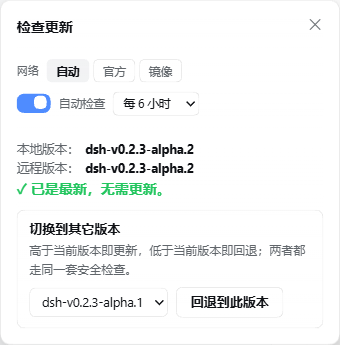
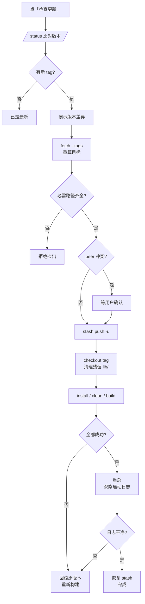

<div align="center">


# dsh-update

**给本地 DeepSeek Harness 用的更新按钮。**

比版本 → 看更新内容 → 确认 → 拉取重建 → 自动重启，全程在侧栏的一个小浮层里。

[](CHANGELOG.md)
[](LICENSE)
[](#兼容性)
[](#安装)

</div>

**目录** · [它解决什么问题](#它解决什么问题) · [长什么样](#长什么样) · [特性](#特性) · [安装](#安装) · [配置](#配置) · [工作机制](#工作机制) · [兼容性](#兼容性) · [排障](#排障) · [开发](#开发)

---

## 它解决什么问题

`dsh web` 跑的是你自己 clone 的 deepseek-harness 仓库。新版本发布时，你要手动做这些事：

```
git fetch --tags → 找到最新的 dsh-v* → 停掉服务 → git checkout → pnpm install
  → pnpm run clean → pnpm run build → 重新起服务 → 发现插件没加载 → 再回滚
```

这套流程每一步都能出错，而最后一步最伤：**构建退出码是 0 不代表能用**。旧版本遗留的 `lib/` 会让新版本停在 `Failed to load plugins`，这时候人已经关掉终端了。

这个插件把整条链路包起来，并且把「出错之后怎么办」当成一等公民：检出前查必需路径、更新前扫描 peer 冲突、构建后观察启动日志、任何一步失败都自动回到你原来的版本、本地未提交的改动全程不丢。

## 长什么样

### 侧栏按钮

侧栏底部的一行按钮，**位置是自适应的**：兄弟按钮高度和我们差不多就并排，差得多就自己占一行（下例里 Remote 是 42px、我们 32px，高低错落所以分了行）。

<p align="left"></p>

### 检查更新浮层

点开后是一个贴着按钮弹出的浮层，不是全屏遮罩——侧栏折叠到 98px 宽时它依然完整可读：

<p align="left"></p>

<table>
<tr>
<td></td>
<td></td>
</tr>
<tr>
<td align="center"><sub>侧栏折叠到 98px，浮层照常显示</sub></td>
<td align="center"><sub>English（三语之一）</sub></td>
</tr>
</table>

### 执行时的进度条

更新一开始浮层就消失，**按钮自己变成进度条**——填充宽度就是百分比，文字显示当前阶段和进度：

<p align="left"></p>

## 特性

### 版本对比

读本地 checkout 的 tag 与 HEAD，跟 origin 的 `dsh-v*` 发布 tag 比对（`git ls-remote`，只读不改仓库）。发现新版本之前**不会自动做任何事**——只告诉你差多少，按钮文字变成「有新版本」并带红点，等你按。

### 三种网络来源

浮层顶部可以直接换链路，选择记在 `localStorage` 里：

| 来源 | 行为 |
|---|---|
| **自动**（默认） | 先直连 GitHub，超时（8 秒）后按镜像清单逐个重试，首个成功的记住 |
| **官方** | 只走 GitHub 直连，可填本地代理端口（Clash / V2Ray 的 7890 之类） |
| **镜像** | 指定用 `gh-proxy.com` / `ghproxy.net` / `ghfast.top` 之一 |

代理端口**默认留空 = 直连**，不预填 7890——否则没开代理的人一进面板就是红的。执行更新（`/run`）也走你选的这条链路，不只是检查。

### 自动检查

开关 + 间隔，默认开启、**每 6 小时**（可选 1 / 6 / 12 / 24）。每次 `dsh web` 启动额外查一次。后台检查发现新版只改按钮外观（文字 + 红点），不弹窗、不打断你。检查失败静默换镜像，绝不弹错误框。

### 一条龙更新

```
git fetch --tags
  ↓ 按刚拉到的 tag 重算目标（避免拿旧列表做决策）
必需路径检查 → peer 冲突检查
  ↓
git stash push -u    （保住你的未提交改动，含未跟踪文件）
git checkout <tag>
  ↓ 删除已消失包的残留 lib/
pnpm install → pnpm run clean → pnpm run build
  ↓ 全部通过才算完成
自动重启 → 观察启动日志 → 健康则结束，不健康则回滚
```

全程以 `text/event-stream` 流式返回，每一步的输出实时显示。

### 四个安全闸门

更新最容易出事的地方不是「拉不下来」，是「拉下来之后不能用」。这四个闸门对应四种真实翻车：

| 闸门 | 拦什么 | 怎么放开 |
|---|---|---|
| **必需路径** | 目标 tag 里没有 `packages/client/ui-context-menu/package.json`（提供 `contextMenus`）——检出后 Web UI 会停在 `Failed to load plugins` | 面板上点「仍要检出」，或设 `allowMissingRequiredPaths: true`；`requiredPaths: []` 直接关掉 |
| **Peer 冲突** | 已装插件的 harness / dsh `peerDependencies` 罩不住目标版本（WorkBuddy 一类钉版本） | 默认列出后由你确认，可改 `block` / `ignore` |
| **残留 lib/** | 旧版本 gitignore 的 `lib/` 在包目录被新 tag 删掉后仍留在磁盘（典型：旧 `ui-context-menu/lib` 继续注入 `contextMenus`） | 自动处理：只删白名单根目录（`packages/`、`apps/`）下「旧树有、新树没有」的包的 `lib/` |
| **启动日志** | 构建成功但重启后日志出现 `did not activate` / `Failed to load plugins` | 自动回滚，不需要你干预 |

`pnpm run clean` 失败同样中止并回滚——不再当作警告继续 build。**构建退出码 0 从来不算成功**，要等启动日志在观察窗口（默认 15 秒）内保持干净。

### 版本回退

后悔了就在「切换到其它版本」里选一个历史 `dsh-v*` tag。同一个下拉、同一套流程，按钮文字按版本高低自动变成「更新到此版本」或「回退到此版本」：

```
高于当前版本 → 更新到此版本
低于当前版本 → 回退到此版本
两者都走同一套安全检查
```

回退被挡住时（本地改动冲突 / 目标版本缺必需路径 / peer 不兼容），浮层会**直接把原因摊开**：冲突的文件清单、不兼容的插件条目、缺哪个路径，并说明该做什么。不会只甩一句「打开检查更新面板查看详情」然后让你无路可走。

### 本地改动不会丢

- 更新前 `git stash push -u`（含未跟踪文件），成功后原样 `stash apply` 回来
- 新版本改到同一文件导致冲突时，改动**安全留在 stash**，面板明确提示「未丢失，可在仓库目录手动 `git stash apply`」
- 面板上有「自动暂存并继续更新 / 回退」按钮，不用自己开终端
- 回滚前会重新 `stash push -u`，避免「回滚把用户改动冲掉」——这条曾经是真 bug

### 失败自动回滚

切换到新版本后，install / clean / build 任一失败，或重启后的启动日志不健康，自动 `git checkout` 回原版本并重新 install / clean / build。回滚过程中 pnpm 再失败时不会假装成功，而是明确告诉你「本地改动安全保存在 git stash 中」——那时树状态不确定，让你手动处理比自动冒险更安全。

### 三语界面

中文 / English / 日本語。语言取源三级：`ctx.locale`（DSH 的 LocaleRuntime）→ `<html lang>` → `navigator.language`，并监听 `<html lang>` 的变化实时切换，不用刷新。其它任何语言（韩法德俄西葡）一律回落**英文**——宁可给英文，也不给半截翻译。

### 并发与安全边界

- 同一时间只允许一个更新任务，重复触发返回 409
- **5 个 API 路由全部 loopback-only**，LAN / 手机来源一律 403
- `/restart` 用更严格的校验：拒绝 `x-forwarded-for` 等代理头，Origin 必须与 Host 精确一致
- 所有 git 调用强制 `GIT_TERMINAL_PROMPT=0`，绝不交互式要凭据
- 回退目标必须是 `dsh-v*` 前缀，拒绝任意 ref

## 安装

> 本插件是 **Profile Bundle**：`package.json` 声明了 `dsh.bundle` 并携带 `cordis.patch.yml`。所以 `dsh plugin add` **一条命令装完即自动激活**，不用手改任何配置文件。

### 从 npm（推荐）

```bash
dsh plugin --profile web add @zhucy123/dsh-update
dsh web
```

### 从 GitHub

```bash
dsh plugin --profile web add git+https://github.com/Zhucy123/dsh-update.git
dsh web
```

### 从本地源码（开发用）

`link:` 会在 `node_modules` 里建符号链接指向源码目录，改代码不用重装。

```bash
dsh plugin --profile web add link:<源码目录绝对路径>
dsh web
```

```powershell
# Windows PowerShell 写法示例
dsh plugin --profile web add link:C:\Users\me\workspace\dsh-update
```

> **装完必须完全重启 `dsh web`。** 不是刷新页面，不是另开终端再跑一次——要停掉旧进程再启动。

> 插件 ID 与路由前缀都是 `dsh-update`；npm 上的裸名 `dsh-update` 已被第三方注册成 1.3KB 的占位空壳包，所以用 scoped 名发布。装好后看不出区别。

## 配置

全部可选。写在 profile 的 `cordis.patch.yml` 用户补丁层：

```yaml
# ~/.dsh/profiles/web/cordis.patch.yml
plugins:
  '@zhucy123/dsh-update':
    peerConflictPolicy: confirm
    bootHealthWindowMs: 20000
```

| 字段 | 环境变量 | 说明 | 默认 |
|---|---|---|---|
| `repoDir` | `DSH_UPDATE_REPO_DIR` | 要更新的仓库根目录 | 从 `process.cwd()` 向上找第一个含 `.git` 的目录 |
| `gitProxy` | `DSH_UPDATE_GIT_PROXY` | 直连失败后的镜像前缀；`""` 关闭镜像回退 | `https://gh-proxy.com/` |
| `allowRestart` | — | 是否允许自重启；检测到 systemd 等 supervisor 时自动禁用 | `true` |
| `autoRestart` | — | 更新 / 回退成功后是否约 2 秒自动重启 | `true` |
| `windowsDetachedUpdate` | — | Windows 后台分离更新，见下 | `false` |
| `requiredPaths` | `DSH_UPDATE_REQUIRED_PATHS` | 检出前必须存在于目标 tag 的相对路径。空数组 = 关闭检查 | `["packages/client/ui-context-menu/package.json"]` |
| `allowMissingRequiredPaths` | — | `true` 时缺路径只警告、仍检出 | `false` |
| `orphanLibRoots` | — | 允许清理残留 `lib/` 的仓库一级目录 | `["packages", "apps"]` |
| `peerConflictPolicy` | — | `confirm`（列出后确认）/ `block`（直接拒绝）/ `ignore`（只记日志） | `confirm` |
| `profilesDir` | `DSH_UPDATE_PROFILES_DIR` | 扫描插件 peer 的 profile 根目录 | `~/.dsh/profiles` |
| `bootHealthWindowMs` | — | 端口起来后继续观察启动日志的毫秒数（0–120000）。自动重启关闭时不做这项检查 | `15000` |

### Windows 后台分离更新

Windows 上跑着的 `dsh` 可能占着旧 `node_modules` 的文件句柄，进程内 `pnpm install` 删不掉被锁的包（`[WARN] Failed to remove ...`），然后触发回滚。

设 `windowsDetachedUpdate: true` 后，更新在 git 步骤完成后移交给一个 detached 后台进程——本进程退出释放句柄，后台进程等端口释放后执行 install → stash apply → clean → build，成功自动重启、失败回滚并写日志到 `%TEMP%\dsh-update-apply-*.log`。

**代价是页面会在交接那一刻断开，需要稍后刷新。** 所以默认关闭：进程内路径全程可见、不断线，只有真的撞上文件锁才值得开。

## 工作机制



### API 路由

| 路由 | 方法 | 说明 |
|---|---|---|
| `/api/dsh-update/status` | GET | 版本对比 + 本地历史 tag 列表；`?source=&mirror=&proxyPort=` 可按当前网络来源重查 |
| `/api/dsh-update/ping` | GET | 极轻量探活，返回 `boot` / `pid` / `inFlight`，重启轮询专用（不读 git、不扫 profile） |
| `/api/dsh-update/release-notes?tag=` | GET | 指定版本的 GitHub Releases 说明 |
| `/api/dsh-update/run` | POST | 流式执行更新 / 回退（`text/event-stream`） |
| `/api/dsh-update/restart` | POST | 按原始启动命令拉起新进程 |

## 兼容性

| 平台 | 状态 | 说明 |
|---|---|---|
| Windows | ✅ | `pnpm` 经 shell 走 `.cmd` shim；重启用 PowerShell `-WindowStyle Hidden` + `windowsHide` 静默拉起 |
| Linux | ✅ | 无 pnpm 时自动回退 `corepack pnpm` |
| macOS | ✅ | 同 Linux |

- 路径统一经 `node:path`，不写死分隔符
- POSIX 重启用 `detached: true` 让新进程成为独立会话，关掉启动它的终端不影响服务，输出重定向到 tmpdir 日志
- systemd 托管时自动禁用自重启（由 supervisor 负责拉起）；launchd 等未识别场景默认允许

**要求**：已 clone 的 deepseek-harness checkout（含 `dsh-v*` tag 的 origin）、Node.js ≥ 18、git、pnpm。

## 排障

| 现象 | 处理 |
|---|---|
| 装完按钮不出现 | 99% 是没**完全重启**（只是刷新了页面）。停掉旧 `dsh web` 进程再启动 |
| 面板一直停在「正在检查版本…」 | 网络问题。换到「镜像」来源再试；检查失败会在提示里给出直连与镜像各自的错误 |
| 提示「已有更新正在执行中」(409) | 并发保护，等当前任务结束 |
| 提示缺少必需路径 | 目标 tag 会损坏 Web UI（典型缺 `ui-context-menu`）。换一个版本，或确认风险后点「仍要检出」 |
| 列出 WorkBuddy 等插件的 peer 冲突 | 已装插件把 harness / dsh 包钉在旧版本。确认后仍可继续，或改 `peerConflictPolicy` |
| 更新后 `MISSING_EXPORT` / 打不开 | 旧残留 `lib/` 引用了已删除的导出。插件会自动 `pnpm run clean` 并清理已消失包的 `lib/`；手动操作时记得 `pnpm run clean && pnpm run build` |
| 启动日志出现 `Failed to load plugins` / `did not activate` | 插件已经自动回滚了，页面恢复后重开面板能看到回滚结果 |
| 更新完仍显示「有更新」 | 面板只在打开时 / 点「重新检查」时刷新。多标签页或开着的旧面板会停在旧视图 |
| 按钮一直是个绿勾、点不动 | v1.9.0 起修掉了：`done` / `error` 态点击即回 `idle` 并重查 |

### 验证安装

```powershell
# 1. 依赖已写入
Get-Content $HOME\.dsh\profiles\web\package.json | Select-String dsh-update

# 2. 依赖已就位（link: 方式是 Junction）
Get-Item $HOME\.dsh\profiles\web\node_modules\@zhucy123\dsh-update
```

然后重启 `dsh web`，侧栏底部应出现「检查更新」按钮。

## 开发

```bash
git clone https://github.com/Zhucy123/dsh-update.git
cd dsh-update
node --test test/*.test.mjs
dsh plugin --profile web add link:$(pwd)
```

```
lib/index.js                2328 行  host 端：API 路由、更新/回退管线、stash、启动健康检查
lib/client.js               2250 行  浏览器端：侧栏按钮、浮层、i18n（classic script，无构建）
lib/safety.js                592 行  纯函数：tag 比较、peer 冲突、路径白名单、环境清理
test/update-safety.test.mjs  477 行  20 条测试
icon.svg                      18 行  插件图标（128 网格）
```

```bash
node --test test/*.test.mjs
# ℹ tests 20 · pass 19 · fail 0 · skip 1
```

唯一 skip 的是需要创建符号链接的用例——Windows 没开开发者模式时 `symlinkSync` 抛 EPERM，已改成能力探测后 skip，不是坏掉。

20 条里有 6 条是**运行时行为测试**（真的起 git 子进程、真的跑一次注定失败的回滚），不是源码正则：

```
runUpdateStreaming resolves and closes the stream on a non-git directory
buildDoneEvent keeps autoRestart honest for both modes
createProcessRunners streams a real git command and reports its exit code
performRollback reports failure instead of throwing when it cannot restore
sanitizeGitEnv strips every malformed GIT_CONFIG_* shape git rejects
a git call survives a poisoned GIT_CONFIG_* environment
```

### 几条硬约束（改代码前必读）

1. **`lib/client.js` 没有构建步骤**——是 classic script，靠 `window.__ModuleLoader__.load({ id, factory })` 注册，内部 `require("react")` 拿平台模块。不能改成 ESM/TS、不能裸 import、不能加打包工具。
2. **`lib/client.js` 是 CRLF + tab 缩进**，含约 185 条 `tr("中文原文")` 字典项。改它必须用精确匹配（含 `\r\n`）。
3. **React 只用 `useState / useEffect / useRef / useCallback` + `createElement`（别名 `h`）**，无 JSX。
4. **host 端路由都是 loopback-only**，这是刻意的安全边界，别为了「方便测试」放开。

### 两类改动，两种生效方式

| 改了 | 怎么生效 |
|---|---|
| `lib/client.js` | 硬刷新页面即生效（`link:` 安装） |
| `lib/index.js` / `lib/safety.js` / `package.json` | 必须重启 `dsh web` |

### 行尾与 `.gitattributes`

仓库统一 `* text=auto eol=crlf`：仓库内以 LF 存储，工作树检出 CRLF。这覆盖了系统级 `core.autocrlf=true`，避免提交时反复出现 `LF will be replaced by CRLF`。

> 如果你遇到「加了 `.gitattributes` 警告还在」，先看 `git ls-files --eol` 里有没有 `-text`——多半是某个文件藏着游离的裸 CR（`\r` 后面不是 `\n`），git 会把它判成 binary，属性对二进制文件不生效。

## 版本历史

当前 **v2.0.0**。完整逐版本记录见 [CHANGELOG.md](CHANGELOG.md)。

## 隐私

**本仓库不包含任何用户本地数据。** 源码里只出现公开产品名 `deepseek-harness` 与 DSH 默认端口 `3080`，没有用户名、绝对工作目录、凭证或 token。仓库只含 `lib/`、`test/`、`docs/`、`package.json`、`cordis.patch.yml`、`icon.svg`、`README.md`、`CHANGELOG.md`、`LICENSE`。

## License

MIT © Zhucy123
