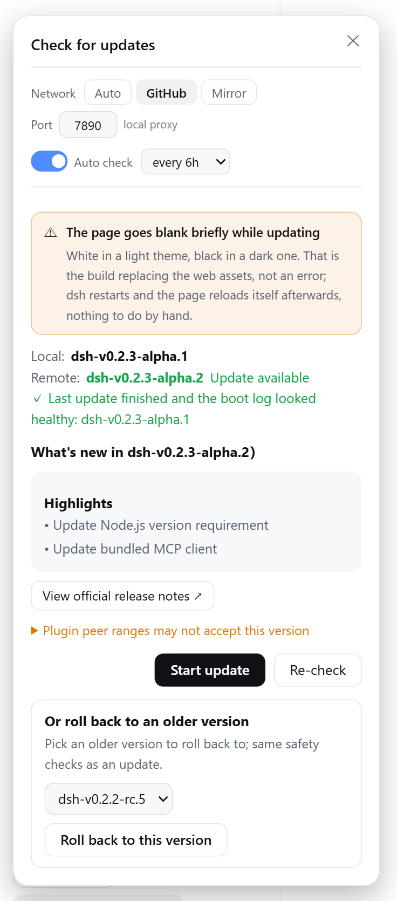
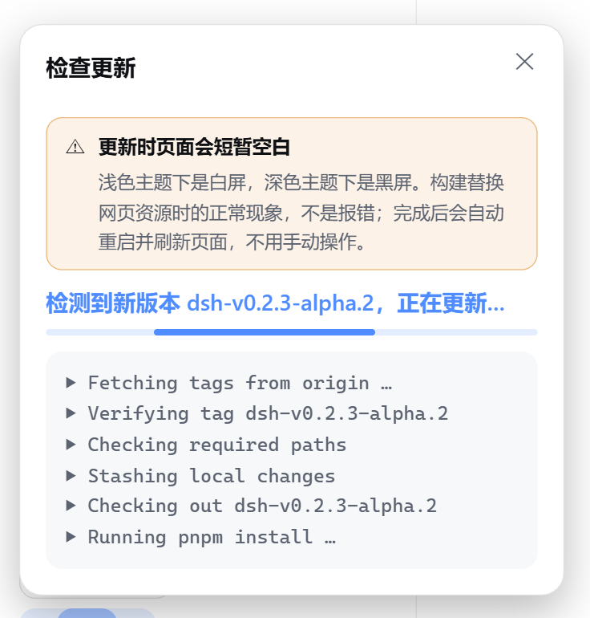
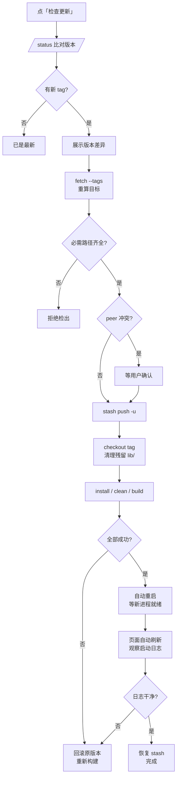

<div align="center">


# dsh-update

**DeepSeek Harness 网页版（web）的更新插件。**

在侧栏点一下就能升级 DSH，不用再手敲一串 git 和 pnpm 命令。

[](CHANGELOG.md)
[](LICENSE)
[](#兼容性)
[](#安装)

</div>

<p align="right"><b>简体中文</b> · <a href="README.en.md">English</a> · <a href="README.ja.md">日本語</a></p>

**目录** · [它解决什么问题](#它解决什么问题) · [长什么样](#长什么样) · [特性](#特性) · [安装](#安装) · [配置](#配置) · [工作机制](#工作机制) · [兼容性](#兼容性) · [排障](#排障) · [开发](#开发)

---

## 它解决什么问题

从源码跑起来的 DSH web，升级一次要手动敲一长串命令——拉 tag、停服务、checkout、install、clean、build、再起服务，中间每一步都可能出错，最后还要自己起回来。

装了插件之后，侧栏底部多一个「检查更新」按钮：检查有没有新版本，你点了才开始更新，构建完自动重启、页面自己回来，出错就退回原来的版本。要你操心的只有**确认**这一件事，其余（拉取、暂存本地改动、重建、回滚）都由它处理。

## 长什么样

### 侧栏按钮

按钮在侧栏底部，**宽度跟着文字走**，不撑满整行。同一行里兄弟按钮高度接近就并排，差得多就自己占一行——下面这张图中 Remote 是 42px、我们是 32px，所以各占一行：

<p align="left"></p>

### 检查更新浮层

点开是贴着按钮弹出的浮层，不是全屏遮罩。它被 portal 到 `body` 并固定定位，所以侧栏折叠成窄条时也不会被裁掉：

<table>
<tr>
<td></td>
<td></td>
</tr>
<tr>
<td align="center"><sub>中文</sub></td>
<td align="center"><sub>English</sub></td>
</tr>
</table>

### 执行时的进度条

开始更新后窗口不会关掉，而是就地变成一个进度窗（右上角有 ✕ 可以自己关掉；关掉后点侧栏按钮还能再打开，任务本身不受影响）。窗口里是一条从左往右匀速跑、循环往复的色带——服务端只报阶段、不报总时长，所以不显示百分比，只要还在动就说明没卡死。

侧栏按钮同时变成进行时文案（安装中 / 构建中…），跑的是同一条色带。完成时变绿显示「更新完成」或「回退完成」。

<table>
<tr>
<td valign="top"></td>
<td valign="top"></td>
</tr>
<tr>
<td align="center"><sub>进度窗（点 ✕ 可关，任务继续跑）</sub></td>
<td align="center"><sub>侧栏按钮</sub></td>
</tr>
</table>

## 特性

### 版本对比

用 `git ls-remote` 读 origin 上的 `dsh-v*` 发布 tag，跟本地比对。全程只读，不改仓库。发现新版本不会自动动手，只是把按钮变成「有新版本」，并在文字**右侧**加一个红点（排在文字后、不覆盖笔画），等你点。

### 三种网络来源

浮层顶部可以直接换链路，选择（含官方模式的代理端口、镜像 id）记在浏览器 `localStorage` 里，下次打开面板自动恢复，不用每次重选：

| 来源 | 行为 |
|---|---|
| **自动**（默认） | 先直连 GitHub，超时（8 秒）后按 `gitProxy` 与镜像清单（`gh-proxy.com` / `ghproxy.net` / `ghfast.top`）逐个重试，并记住首个可用镜像 |
| **官方** | 只走 GitHub 直连，可填本地代理端口（Clash / V2Ray 的 7890 之类） |
| **镜像** | 指定用 `gh-proxy.com` / `ghproxy.net` / `ghfast.top` 之一；非 GitHub `origin` 选择该模式会立即报错提示，不会继续执行 |

代理端口留空就是直连。选「官方 + 本地代理端口」时现在**全程生效**：不仅覆盖版本检查（`git ls-remote`）与更新/回退拉取（`git fetch`），也通过 Node 内置 `node:http` / `node:tls` 的 HTTP `CONNECT` 隧道覆盖 `/api/dsh-update/release-notes` 拉取 GitHub 发布说明。

经第三方镜像站（`gh-proxy.com` / `ghproxy.net` / `ghfast.top` 或 `gitProxy`）拉取后，插件会自动向 GitHub 官方 API 核对目标 tag 的 commit SHA（不一致立即中止，绝不检出）；若官方 API 不可达，默认提示风险并继续（此时依赖对该第三方镜像的信任），如要求强制核验可开启 `verifyMirrorSha: true`；对信任边界要求严格时请选用「官方 + 本地代理」。

### 自动检查

默认开启，每 6 小时查一次，可选 1 / 6 / 12 / 24 小时。每次 `dsh web` 启动也会查一次。后台查到新版本只改按钮外观，不弹窗、不打断你；失败会静默换镜像重试。

### 一条龙更新

```
git fetch --tags
  ↓ 按刚拉到的 tag 重算目标（避免拿旧列表做决策）
必需路径检查 → peer 冲突检查
  ↓
git stash push -u    （保住你的未提交改动，含未跟踪文件）
git checkout <tag>
  ↓ 删除已消失包的残留 lib/
pnpm install → pnpm run clean → pnpm run build
  ↓ 全部通过才算完成
自动重启 → 等新进程起来 → 页面自动刷新 → 观察启动日志
  ↓ 日志不健康则回滚
```

全程以 `text/event-stream` 流式返回，每一步的输出实时显示。

### 自动重启，页面自己回来

构建成功后 dsh 会自动重启（完成提示里是真实倒计时，约 2 秒），页面不用你手动刷新，也不用盯终端：

插件先记住当前进程的 `boot` id，然后每 0.6 秒请求一次 `/api/dsh-update/ping`（首轮 250 毫秒后就开始）。看到 `boot` 变了就说明新进程已经绑上端口，这时才 `location.reload()`。这个 `boot` 基准还会写进浏览器 `localStorage`——即使 build 阶段替换网页资源导致页面变空白、SSE 连接断开，页面重新加载时也会独立轮询 `/ping` 感知新进程并补上刷新，不依赖那条可能断开的 SSE。

刷新前还会再确认一次「本页需不需要刷」：`boot` 的前半段就是服务端进程的启动时刻，若它早于本页面加载时刻，说明本页本来就是新进程在服务，只清标记、不再 reload——所以你自己按过 F5 之后，不会再被多刷一次。

之所以不直接刷新：旧进程退出、新进程还没监听端口之间有一段空窗，立刻 reload 只会撞上「无法访问此网站」。等新进程确认就绪再刷新，页面是直接回到正常界面的。

实测下来，真正「页面不可用」的时间比直觉短得多：以 2 秒一次的采样观察一次真实更新，`dist` 被清空到重建完成只有 **约 2 秒**，重启空窗（进程还没绑端口）**约 18 秒**；而此前宿主 `tsc` 编译的那几分钟里，`dist` 一直是完好的，页面可以照常用——所以这段时间并不产生白屏。

- 轮询默认 90 秒（后台分离模式会下发更长的窗口）；重启空窗期连不上 `/ping` 属正常，继续轮询
- 超过窗口就不再等，把控制权交回给你，不把你锁在死循环里
- 自动重启没生效时（比如配置里关了），完成面板会显示「重启失败，请手动重启」，旁边的「立即重启」可以补一次
- 检测到 system/user systemd、PM2、supervisord、macOS launchd、容器等 supervisor 托管、或设了 `allowRestart: false` 时不做自动重启，也就不轮询

### 四个安全闸门

更新最容易出问题的地方不是拉不下来，而是拉下来之后不能用。下面四道检查对应四种真实故障：

| 闸门 | 拦什么 | 怎么放开 |
|---|---|---|
| **必需路径** | 目标 tag 里没有 `packages/client/ui-context-menu/package.json`（提供 `contextMenus`）——检出后 Web UI 会停在 `Failed to load plugins` | 面板上点「仍要检出」，或设 `allowMissingRequiredPaths: true`；`requiredPaths: []` 直接关掉 |
| **Peer 冲突** | **已启用**插件的 harness / dsh `peerDependencies` 罩不住目标版本（WorkBuddy 一类钉版本）。只扫 `dsh.profile.bundles` 里启用的插件（支持软链接 / Junction 安装的插件目录）；支持标准 npm semver 范围（含空白分隔操作符与连字符范围），prerelease 目标按其稳定版二次确认避免误报 | 默认列出后由你确认，可改 `block` / `ignore` |
| **残留 lib/** | 旧版本 gitignore 的 `lib/` 在包目录被新 tag 删掉后仍留在磁盘（典型：旧 `ui-context-menu/lib` 继续注入 `contextMenus`） | 自动处理：只删白名单根目录（`packages/`、`apps/`）下「旧树有、新树没有」的包的 `lib/` |
| **启动日志** | 构建成功但重启后日志出现 `did not activate` / `Failed to load plugins` | 自动回滚，不需要你干预 |

`pnpm run clean` 失败同样中止并回滚，不会当成警告继续构建。构建退出码是 0 也不算成功，要等启动日志在观察窗口（默认 15 秒）内保持干净。

### 版本回退

想回退就在面板的「或回退到历史版本」里挑一个比当前旧的 `dsh-v*` tag，按钮固定显示「回退到此版本」。tag 比较与版本排序在 prerelease 版本号（如 `alpha.10` vs `alpha.2`）采用完整 semver 数值比较。版本区只列历史版本——升级由顶部的「开始更新」负责，两者不重复；「已是最新」时也只有回退区，不会再出现自相矛盾的「更新到此版本」。回退和更新走同一套安全检查。

回退成功后同样自动重启、页面自动刷新，不需要手动操作。

回退被安全闸门挡住时（本地改动冲突、目标版本缺必需路径、peer 不兼容），浮层会弹出确认卡片列出原因：哪些文件冲突、哪个插件不兼容、缺哪条路径，按钮显示「仍要继续回退」。点「仍要继续」会保留已走过的进度接着跑；点「取消」按钮恢复正常状态。冲突详情默认折叠，不再刷屏。

### 本地改动不会丢

- 自动暂存前先用 `git status --porcelain` 判空——工作树干净时不执行 `git stash push`，避免误动你原有的 `stash@{0}`
- 有改动时在更新前 `git stash push -u`（含未跟踪文件），成功后原样 `stash apply` 回来
- 新版本改到同一文件导致 `stash apply` 冲突时，**保留 stash 条目不丢弃**并用 `git reset --hard HEAD` 干净恢复工作树再继续构建，面板明确提示「未丢失，可在仓库目录手动 `git stash apply`」
- 面板上有「自动暂存并继续更新 / 回退」按钮，不用自己开终端
- 回滚前同样先用 `git status --porcelain` 检查并在有改动时重新 `stash push -u`，避免回滚把用户改动冲掉

### 失败自动回滚

切到新版本后，install / clean / build 任一失败，或重启后启动日志不健康，会自动 `git checkout` 回原版本并重新构建。回滚过程中 pnpm 再失败时不会假装成功，而是明确告诉你「本地改动安全保存在 git stash 中」——那时工作树状态不确定，交给你手动处理比自动冒险稳妥。

### 三语界面

中文 / English / 日本語。语言依次取自 `ctx.locale`（DSH 的 LocaleRuntime）、`<html lang>`、`navigator.language`，并监听 `<html lang>` 变化实时切换，不用刷新。其它语言一律回落英文，不给半截翻译。

### 并发与安全边界

- 同一时间只允许一个更新任务，重复触发返回 409
- 5 个 API 路由全部注册在 DSH 的**共享 `/api` 鉴权通道**（`ctx.connection.fetch.register`）。宿主在请求到达插件前统一做 Host/Origin 信任栅栏（防 DNS rebinding / 跨域调用）与浏览器登录态校验——你在浏览器里打开的任何网页都无法再调用它们。返回 401/403 的是宿主，不是插件自己
- `/run` / `/restart` 这类会真正改动系统的端点因此同样受登录态保护；插件侧只保留策略校验（supervisor / `allowRestart` / 进行中任务 / 目标 tag 白名单）
- `POST /api/dsh-update/run` 限制请求体不超过 64 KiB（超限返回 413），非法或非对象 JSON 返回 HTTP 400（不再静默按空参数继续）
- 检测到「有对话正在进行」时，强制更新二次确认会完整保留用户的自动暂存（`stash`）等选项；在 `done` / `error` 态点击侧栏按钮重查也会沿用已选择的网络来源与代理配置
- 重启与后台安装探测监听端口时优先解析宿主真实监听端口，并同时检查 `127.0.0.1` 与 `::1`（IPv6 回环）；detached helper 通过 `tmpdir()` 临时 `.cjs` 脚本执行并等待 `'spawn'` 确认后再向宿主发 `SIGTERM`
- 所有 git 调用强制 `GIT_TERMINAL_PROMPT=0`，绝不交互式要凭据；输出流与错误中的 URL 内嵌凭据（`https?://user:pass@`）自动脱敏为 `***@`
- 直连与代理拉取 GitHub 发布说明均强制 2MB 体积上限，HTTP `CONNECT` 隧道显式锁定 `ALPNProtocols: ['http/1.1']`
- 回退目标必须是 `dsh-v*` 前缀，拒绝任意 ref
- 镜像拉取后自动向 GitHub 官方 API 核对目标 tag 的 commit SHA（不一致立即中止，绝不检出）；官方 API 不可达时默认提示风险并继续，配置 `verifyMirrorSha: true` 时改为严格中止（对信任边界要求严格时请选用「官方 + 本地代理」）
- 检查与更新前校验目标目录是否为 `deepseek-harness` 仓库（并拒绝 npm 安装的 `@deepseek-ai/dsh`，除非配置 `allowUnverifiedRepo: true`）；HEAD 存在未打 `dsh-v*` tag 的本地提交时默认拒绝检出（除非配置 `allowLocalCommits: true`）
- 需要 DSH `>=0.2.3`（含 alpha），因为该版本起共享 `/api` 通道的准入模型才稳定；`engines.dsh: ">=0.2.3-0"` 覆盖 `0.2.3-alpha.*`

## 安装

> 本插件是 **Profile Bundle**：`package.json` 声明了 `dsh.bundle` 并携带 `cordis.patch.yml`。所以 `dsh plugin add` **一条命令装完即自动激活**，不用手改任何配置文件。

### 从 npm（推荐）

```bash
dsh plugin --profile web add @zhucy123/dsh-update
dsh web
```

### 从 GitHub

```bash
dsh plugin --profile web add git+https://github.com/Zhucy123/dsh-update.git
dsh web
```

### 从本地源码（开发用）

`link:` 会在 `node_modules` 里建符号链接指向源码目录，改代码不用重装。

```bash
dsh plugin --profile web add link:<源码目录绝对路径>
dsh web
```

```powershell
# Windows PowerShell 写法示例
dsh plugin --profile web add link:C:\Users\me\workspace\dsh-update
```

> **装完必须完全重启 `dsh web`。** 不是刷新页面，不是另开终端再跑一次——要停掉旧进程再启动。

> 插件 ID 与路由前缀都是 `dsh-update`；npm 上的裸名 `dsh-update` 已被第三方注册成 1.3KB 的占位空壳包，所以用 scoped 名发布。装好后看不出区别。

## 配置

全部可选。写在 profile 的 `cordis.patch.yml` 用户补丁层：

```yaml
# ~/.dsh/profiles/web/cordis.patch.yml
plugins:
  '@zhucy123/dsh-update':
    peerConflictPolicy: confirm
    bootHealthWindowMs: 20000
```

| 字段 | 环境变量 | 说明 | 默认 |
|---|---|---|---|
| `repoDir` | `DSH_UPDATE_REPO_DIR` | 要更新的仓库根目录（必须是 git checkout） | 从 `process.cwd()` 向上找第一个含 `.git` 的目录 |
| `gitProxy` | `DSH_UPDATE_GIT_PROXY` | 直连失败后的镜像前缀；`""` 关闭镜像回退 | `https://gh-proxy.com/` |
| `allowRestart` | — | 是否允许自重启；检测到 system/user systemd、PM2、supervisord、macOS launchd、容器等 supervisor 时自动禁用 | `true` |
| `autoRestart` | — | 更新 / 回退成功后是否约 2 秒自动重启并等新进程就绪后刷新页面 | `true` |
| `windowsDetachedUpdate` | — | Windows 后台分离更新，见下 | `false` |
| `requiredPaths` | `DSH_UPDATE_REQUIRED_PATHS` | 检出前必须存在于目标 tag 的相对路径。空数组 = 关闭检查 | `["packages/client/ui-context-menu/package.json"]` |
| `allowMissingRequiredPaths` | — | `true` 时缺路径只警告、仍检出 | `false` |
| `orphanLibRoots` | — | 允许清理残留 `lib/` 的仓库一级目录 | `["packages", "apps"]` |
| `peerConflictPolicy` | — | `confirm`（列出后确认）/ `block`（直接拒绝）/ `ignore`（只记日志） | `confirm` |
| `profilesDir` | `DSH_UPDATE_PROFILES_DIR` | 扫描插件 peer 的 profile 根目录 | `~/.dsh/profiles` |
| `bootHealthWindowMs` | — | 端口起来后继续观察启动日志的毫秒数（0–120000）。自动重启关闭时不做这项检查 | `15000` |
| `verifyMirrorSha` | — | `true` 时镜像拉取后若无法向 GitHub 官方 API 核验 tag SHA 则中止更新（SHA 不一致始终中止） | `false` |
| `allowLocalCommits` | — | `true` 时允许在 HEAD 存在未打 `dsh-v*` tag 的本地提交时继续检出 | `false` |
| `allowUnverifiedRepo` | — | `true` 时跳过 `deepseek-harness` 仓库身份校验 | `false` |

### Windows 后台分离更新

Windows 上跑着的 `dsh` 可能占着旧 `node_modules` 的文件句柄，进程内 `pnpm install` 删不掉被锁的包（`[WARN] Failed to remove ...`），然后触发回滚。

设 `windowsDetachedUpdate: true` 后，更新在 git 步骤完成后移交给一个 detached 后台进程——本进程退出释放句柄，后台进程等端口释放后执行 install → stash apply → clean → build，成功自动重启、失败回滚并写日志到 `%TEMP%\dsh-update-apply-*.log`。

**代价是页面会在交接那一刻断开。** 后台进程完成后同样会自动重启并等你回来，但因为交接期间连接已断，需要你自己重新打开页面。所以这项默认关闭：进程内路径全程可见、页面自动刷新，只有真的撞上文件锁才值得开。

## 工作机制



### API 路由

以下路由均注册在 DSH 共享 `/api` 鉴权通道，由宿主统一做信任栅栏与登录态校验，插件本身不接受匿名请求。

| 路由 | 方法 | 说明 |
|---|---|---|
| `/api/dsh-update/status` | GET | 版本对比 + 本地历史 tag 列表；`?source=&mirror=&proxyPort=` 可按当前网络来源重查 |
| `/api/dsh-update/ping` | GET | 极轻量探活，返回 `boot` / `pid` / `inFlight`，重启轮询专用（不读 git、不扫 profile） |
| `/api/dsh-update/release-notes?tag=` | GET | 指定版本的 GitHub Releases 说明 |
| `/api/dsh-update/run` | POST | 流式执行更新 / 回退（`text/event-stream`） |
| `/api/dsh-update/restart` | POST | 按原始启动命令拉起新进程 |

## 兼容性

| 平台 | 状态 | 说明 |
|---|---|---|
| Windows | ✅ | `pnpm` 经 shell 走 `.cmd` shim（超时用 `taskkill /T /F` 清理整个进程树）；重启用 PowerShell `-WindowStyle Hidden` + `windowsHide` 静默拉起 |
| Linux | ✅ | 无 pnpm 时自动回退 `corepack pnpm` |
| macOS | ✅ | 同 Linux |

- 路径统一经 `node:path`，不写死分隔符
- 端口探测（重启与后台更新）同时检查 `127.0.0.1` 与 `::1`
- POSIX 重启用 `detached: true` 让新进程成为独立会话，关掉启动它的终端不影响服务，输出重定向到 tmpdir 日志
- 已识别 system/user systemd、PM2、supervisord、macOS launchd 及 Docker/容器托管并自动禁用自重启（避免双实例抢拉起）；如确需覆盖可显式设置 `allowRestart: true`

**要求**：

- DSH 以源码方式运行——一个 clone 下来的 `deepseek-harness` 仓库，origin 上带 `dsh-v*` 发布 tag；通过 npm 全局或本地安装的 `@deepseek-ai/dsh` CLI 应使用 npm 升级（如 `npm install -g @deepseek-ai/dsh@latest`），本插件会在检查和检出前校验目标目录是否为 `deepseek-harness` 仓库，拒绝误操作无关 git 项目
- Node.js ≥ 18、git、pnpm

## 排障

| 现象 | 处理 |
|---|---|
| 装完按钮不出现 | 99% 是没**完全重启**（只是刷新了页面）。停掉旧 `dsh web` 进程再启动 |
| 面板一直停在「正在检查版本…」 | 网络问题。换到「镜像」来源再试；检查失败会在提示里给出直连与镜像各自的错误 |
| 提示「已有更新正在执行中」(409) | 并发保护，等当前任务结束 |
| 提示缺少必需路径 | 目标 tag 会损坏 Web UI（典型缺 `ui-context-menu`）。换一个版本，或确认风险后点「仍要检出」 |
| 列出 WorkBuddy 等插件的 peer 冲突 | 只统计**已启用**插件把 harness / dsh 包钉在旧版本的情况（已装未启用的不算；alpha 目标按稳定版匹配，避免误报）。确认后仍可继续，或改 `peerConflictPolicy` |
| 更新后 `MISSING_EXPORT` / 打不开 | 旧残留 `lib/` 引用了已删除的导出。插件会自动 `pnpm run clean` 并清理已消失包的 `lib/`；手动操作时记得 `pnpm run clean && pnpm run build` |
| 启动日志出现 `Failed to load plugins` / `did not activate` | 插件已经自动回滚了，页面恢复后重开面板能看到回滚结果 |
| 更新完仍显示「有更新」 | 更新成功时页面会自动刷新，刷新后不会再有这个问题。若是另开的标签页或刷新前就开着的面板，会停在旧视图，点「重新检查」即可 |
| 按钮一直是个绿勾、点不动 | `done` / `error` / `confirm`（待确认）态点击即回 `idle` 并按已选网络来源/代理配置重查；取消拦截卡片按钮也会恢复正常 |
| 更新完页面没自己刷新回来 | 先等几秒：即使 build 阶段页面变空白、SSE 断开，页面重载后仍会靠 `localStorage` 里的 boot 基准补一次自动刷新（约 0.6 秒一轮）。若确实没重启，面板会显示「重启失败，请手动重启」，点「立即重启」；也可 F5 后手动起 dsh。轮询默认等 90 秒，超时交还给你 |

### 验证安装

```powershell
# 1. 依赖已写入
Get-Content $HOME\.dsh\profiles\web\package.json | Select-String dsh-update

# 2. 依赖已就位（link: 方式是 Junction）
Get-Item $HOME\.dsh\profiles\web\node_modules\@zhucy123\dsh-update
```

然后重启 `dsh web`，侧栏底部应出现「检查更新」按钮。

## 开发

```bash
git clone https://github.com/Zhucy123/dsh-update.git
cd dsh-update
node --test test/*.test.mjs
dsh plugin --profile web add link:$(pwd)
```

```
lib/index.js                3421 行  host 端：API 路由、更新/回退管线、stash、启动健康检查、HTTP CONNECT 代理隧道
lib/client.js               2329 行  浏览器端：侧栏按钮、浮层、i18n（classic script，无构建）
lib/safety.js                774 行  纯函数：仓库身份校验、tag 比较、peer 冲突、路径白名单、凭据脱敏、环境清理
test/update-safety.test.mjs 2753 行  69 条测试
icon.svg                      18 行  插件图标（128 网格）
```

```bash
node --test test/*.test.mjs
# ℹ tests 69 · pass 69 · fail 0
```

其中 `revision check and orphan lib deletion use a real git tree` 这条用例需要创建符号链接——在未开启开发者模式的 Windows 上因无 symlink 权限会通过能力探测自动 skip（此时为 68 pass / 1 skipped），并非用例损坏；开启权限或类 Unix 环境实测为 69 条全部通过。

69 条里有若干条是**运行时行为测试**（真的起 git 子进程、真的跑一次注定失败的回滚、真的起本地代理验证 HTTP `CONNECT` 隧道与 Fetch route 的 SSE 流、验证异步 helper 启动失败不杀宿主等），不只是源码正则：

```
runUpdateStreaming resolves and closes the stream on a non-git directory
runUpdateStreaming with stash: true leaves existing stash@{0} untouched when working tree is clean
runUpdateStreaming restores pre-checkout stash when checkout fails after stash: true
handleRun returns 400 for invalid JSON or non-object JSON without locking the latch
unrelated git repository is rejected by /status and /run unless allowUnverifiedRepo is true
verifyMirrorTagSha and mirror fetch validation block SHA mismatches and honor verifyMirrorSha
async spawn failure on /restart returns 500, resets latch, leaves no .cjs files, and does not kill host
performRollback reports failure instead of throwing when it cannot restore
a git call survives a poisoned GIT_CONFIG_* environment
fetchJson tunnels HTTPS through local HTTP CONNECT proxy (normal & chunked) and forwards HTTP GET
```

### 几条硬约束（改代码前必读）

1. **`lib/client.js` 没有构建步骤**——是 classic script，靠 `window.__ModuleLoader__.load({ id, factory })` 注册，内部 `require("react")` 拿平台模块。不能改成 ESM/TS、不能裸 import、不能加打包工具。
2. **`lib/client.js` 是 CRLF + tab 缩进**，含 **177** 条 `tr("中文原文")` 字典项。改它必须用精确匹配（含 `\r\n`）。
3. **React 只用 `useState / useEffect / useRef / useCallback` + `createElement`（别名 `h`）**，无 JSX。
4. **host 端路由必须走 `ctx.connection.fetch.register`**，由宿主统一鉴权；不要再退回裸 `webServer.register` + 自写 loopback fence——那会让浏览器里打开的任意网页都能触发更新。端点方法白名单与 `requestBody`（`/run` 为 `streaming`）要保持和 handler 一致。

### 两类改动，两种生效方式

| 改了 | 怎么生效 |
|---|---|
| `lib/client.js` | 硬刷新页面即生效（`link:` 安装） |
| `lib/index.js` / `lib/safety.js` / `package.json` | 必须重启 `dsh web` |

### 行尾与 `.gitattributes`

仓库统一 `* text=auto eol=crlf`：仓库内以 LF 存储，工作树检出 CRLF。这覆盖了系统级 `core.autocrlf=true`，避免提交时反复出现 `LF will be replaced by CRLF`。

> 如果你遇到「加了 `.gitattributes` 警告还在」，先看 `git ls-files --eol` 里有没有 `-text`——多半是某个文件藏着游离的裸 CR（`\r` 后面不是 `\n`），git 会把它判成 binary，属性对二进制文件不生效。

## 版本历史

当前 **v2.0.2**。完整逐版本记录见 [CHANGELOG.md](CHANGELOG.md)。

## 隐私

**本仓库不包含任何用户本地数据。** 源码里只出现公开产品名 `deepseek-harness` 与 DSH 默认端口 `3080`，没有用户名、绝对工作目录、凭证或 token。仓库只含 `lib/`、`test/`、`docs/`、`package.json`、`cordis.patch.yml`、`icon.svg`、`screenshots.json`、`README.md` / `README.en.md` / `README.ja.md`、`CHANGELOG.md` / `CHANGELOG.en.md` / `CHANGELOG.ja.md`、`LICENSE`。

## License

MIT © Zhucy123
